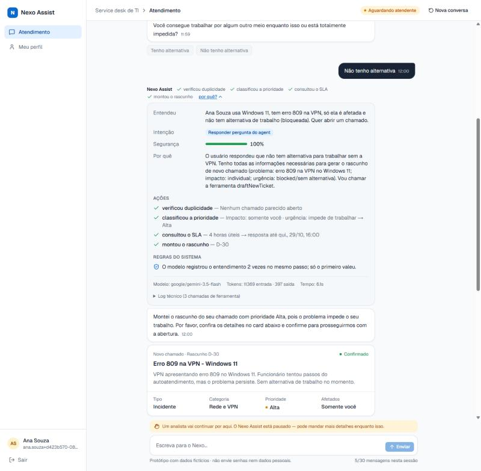
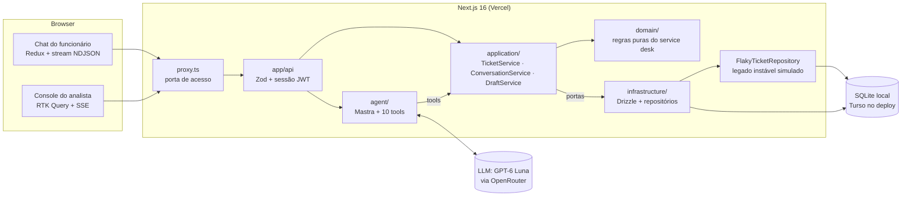
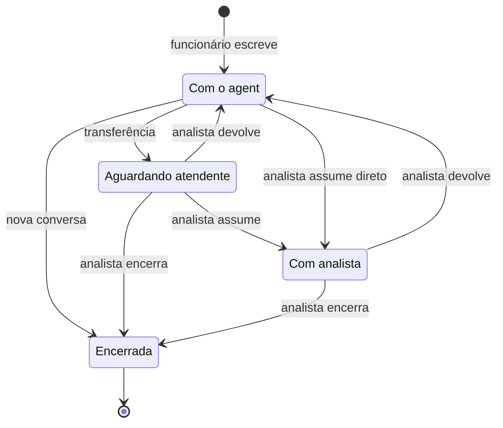
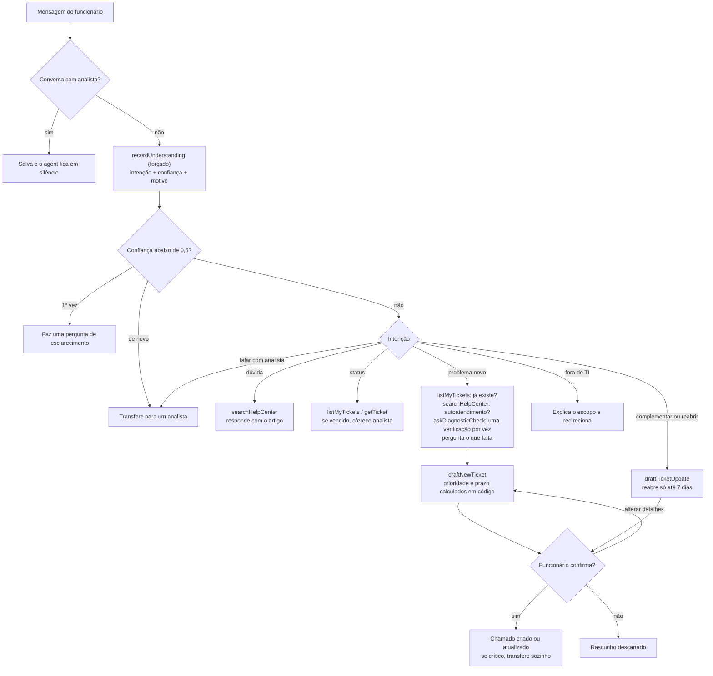
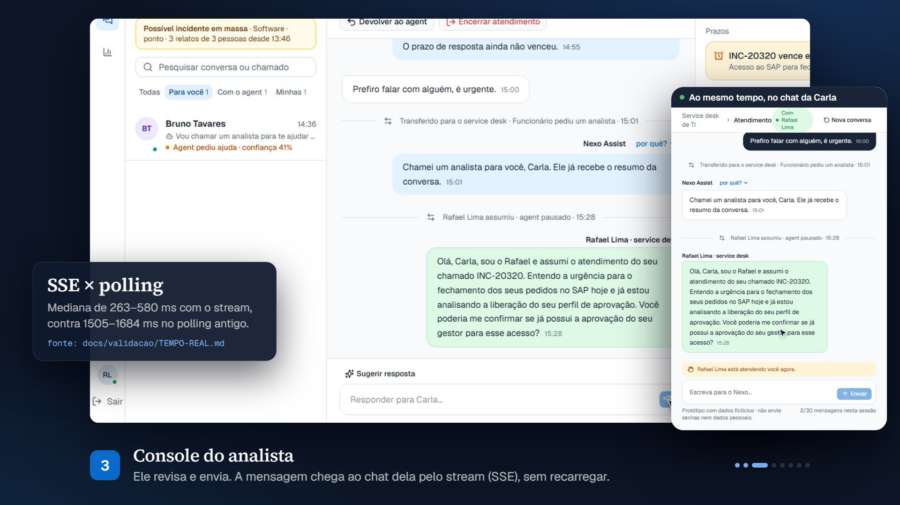

# Nexo Assist

[](https://dl.circleci.com/status-badge/redirect/gh/skarL007/nexo-assist/tree/main) [](https://hub.docker.com/r/skarl007/nexo-assist)

Agent de atendimento do service desk de TI da Nexo. O funcionário descreve o problema com as próprias palavras. O agent consulta os chamados dele, busca na central de ajuda, abre ou atualiza chamados (sempre com confirmação) e chama um analista quando precisa. O analista atende pelo console: vê a fila, assume a conversa com o agent pausado e depois devolve ou encerra.

Cada resposta do agent mostra **o que ele entendeu, o que fez e por quê**: passos ao vivo, decisão com confiança, chamadas de tool com entrada e saída, regras que agiram, tokens e latência.

**Demo pública:** https://nexo-assist-puce.vercel.app. Na tela de login, entre como **Ana · funcionária** ou **Rafael · analista** (um clique, dados fictícios, qualquer senha). Cada navegador recebe um **espaço próprio**, com uma cópia dos dados de exemplo: o que você fizer não aparece para outro avaliador. Para controlar o custo, a demo aceita até **100 mensagens por dia**, somando todos os visitantes. Depois disso, o chat avisa que o limite de hoje acabou.

**Vídeo (5:28):** [assistir no navegador](https://skarl007.github.io/nexo-assist/#video) · [estudo de caso](https://skarl007.github.io/nexo-assist/)

**Stack:** TypeScript estrito · Next.js 16 (App Router) · Mastra (agent) · GPT-6 Luna via OpenRouter (Gemini 3.5 Flash até 30/10) · Drizzle + libSQL (SQLite local, Turso no deploy) · Redux Toolkit + RTK Query · Zod · shadcn/ui + Tailwind · Vitest · Playwright.



*Cada resposta do agent tem um "por quê?": o que ele entendeu, quais ferramentas chamou e quais regras do sistema interferiram. Captura da demo pública.*

---

## Onde cada pedido do desafio está

| O desafio pede | Onde ver |
|---|---|
| Login, chat, cards, seleção de chamado, rascunho, respostas rápidas, limite de 30 mensagens | [Roteiro de 3 minutos](#roteiro-de-3-minutos) · `src/features/chat/`, `src/components/conversation/` |
| Agent que decide seguindo o Anexo A | [Como o agent decide](#como-o-agent-decide) · [O que é garantido em código](#o-que-é-garantido-em-código-não-depende-do-prompt) |
| Serviço de chamados simulado, separado, com legado instável | [Arquitetura](#arquitetura) · `src/application/ticket-service.ts`, `FlakyTicketRepository` |
| Transferência e console do analista (assumir, devolver, encerrar) | [Estados da conversa](#estados-da-conversa) · `src/features/console/` |
| **Visibilidade das decisões** | Botão **"por quê?"** em cada resposta (`components/conversation/decision-details.tsx`) e passos acima da resposta (`agent-steps.tsx`) |
| Persistência após reinício | SQLite/Turso. A prova de fumaça do CI reinicia o container e confere os dados |
| Rodar com poucos comandos + `.env.example` | [Como rodar](#como-rodar) |
| Como garanti a qualidade das decisões | [Qualidade](#como-garanti-a-qualidade-das-decisões) |
| Escolha do modelo | [Escolha do modelo](#escolha-do-modelo) |
| Deploy com chaves protegidas e uso limitado | [Deploy e segurança](#deploy-e-segurança) |
| Trade-offs e o que faria com mais tempo | [Trade-offs](#trade-offs) · [Com mais tempo](#o-que-eu-faria-com-mais-tempo) |

---

## Como rodar

Pré-requisitos: Node 22.9+ e uma chave do Gemini ([Google AI Studio](https://aistudio.google.com/apikey)), usada pelo modelo padrão local e pelos embeddings da busca. Para rodar como a produção, defina também `OPENROUTER_API_KEY` e `LLM_MODEL=openrouter/openai/gpt-6-luna`; com a chave do OpenRouter, os embeddings da busca também passam por ele (o mesmo `gemini-embedding-2`), e o Gemini direto vira reserva.

```bash
npm install
cp .env.example .env          # preencha GOOGLE_GENERATIVE_AI_API_KEY (no cmd.exe: copy)
npm run db:setup              # cria o banco local (local.db) com os dados de exemplo
npm run dev                   # http://localhost:3000 (outra porta: npm run dev -- -p 3001)
```

Ou com Docker, sem instalar Node:

```bash
docker build -t nexo-assist .
docker run --rm -p 127.0.0.1:3000:3000 \
  -e AUTH_SECRET=SEGREDO_COM_32_OU_MAIS_CARACTERES \
  -e GOOGLE_GENERATIVE_AI_API_KEY=SUA_CHAVE \
  -v nexo-data:/data nexo-assist
```

O banco fica no volume e recebe os dados de exemplo no primeiro start. Gere o segredo com o comando do `.env.example` e abra http://localhost:3000 no Chrome, Edge ou Firefox.

Sem a chave, o login, o console do analista e os testes funcionam; o chat avisa que falta configurar `GOOGLE_GENERATIVE_AI_API_KEY`.

Qualquer senha funciona para os usuários de exemplo (regra do desafio). A tela de login tem botões de acesso rápido.

| Quem | E-mail | O que dá para ver |
|---|---|---|
| Ana Souza (funcionária) | `ana.souza@nexo.com.br` | 3 chamados abertos, 1 vencido (INC-20311), 1 resolvido há 4 dias (pode reabrir) |
| Elisa Prado (funcionária) | `elisa.prado@nexo.com.br` | conversa em andamento com o agent |
| Rafael Lima (analista N2) | `rafael.lima@nexo.com.br` | console com 2 conversas na fila |

Outros comandos:

```bash
npm run verify                    # tipos + lint + unitários + E2E + E2E da demo — sem LLM
npm test                          # 466 testes unitários em 67 arquivos — sem LLM
npx playwright install chromium   # só na primeira vez, antes do E2E
npm run test:e2e                  # 42 testes E2E contra o build de produção — sem LLM
npm run test:e2e:demo             # isolamento entre visitantes na demo pública — sem LLM
npm run eval                      # 36 cenários de decisão do agent com o modelo real (8 de ataque)
npm run eval:sim                  # funcionário simulado por um modelo, pass^k (τ-bench)
npm run eval:busca                # busca na central: palavras-chave × híbrida, 63 perguntas (pelo OpenRouter)
npm run eval:sugestao             # sugestão de resposta do analista com o modelo real
npm run otel:local                # coletor OTLP local para ver a telemetria dos turnos
npm run db:seed                   # volta os dados ao estado inicial
```

Para rodar o build local (`npm run build && npm start`), preencha também `AUTH_SECRET` no `.env` (o comando que gera o valor está no [`.env.example`](.env.example)). Todas as variáveis estão documentadas ali e são validadas com Zod em [`src/config/env.ts`](src/config/env.ts). Na aplicação, só esse arquivo e o [`proxy.ts`](src/proxy.ts) (porta de acesso) leem `process.env`.

### Roteiro de 3 minutos

Entre como **Ana** e escreva:

1. **"Qual o horário do service desk?"** → responde pela central de ajuda. Clique em **"por quê?"** para ver a intenção, a confiança, as tools e as regras.
2. **"Como está o chamado do notebook?"** → acha o chamado sem o número (INC-20311 no seed local), mostra que o prazo venceu e oferece um analista.
3. **"Minha VPN dá erro 809, uso Windows 11"** → o artigo vale só para Windows 10, então ele pergunta o que falta e monta um **rascunho**. Use **"Alterar detalhes"** (a prioridade e o prazo mudam ao vivo) e **Confirmar**.
4. **"Quero falar com um analista"** → a conversa vai para a fila. Entre como **Rafael**: abra o **Relatório** da conversa (o que a pessoa precisa, o que o agent já fez e o que está pendente), assuma, use **"Sugerir resposta"** (o modelo escreve, você revisa) e devolva ao agent. A mensagem chega ao chat da Ana em menos de 1 s (SSE).
5. Ainda como **Rafael**, olhe a fila: o chip **"Frustração alta"** da Carla e o aviso de **possível incidente em massa** (três pessoas com o sistema de ponto fora do ar). Pela regra, o aviso dura 4 horas úteis depois do seed; para vê-lo de novo, rode `npm run db:seed`. Em **Indicadores** estão a resolução honesta (confirmada × presumida, sem contar chamado aberto nem quem voltou com o mesmo problema), as lacunas da central e os prazos em risco com a conta explicada.

Na demo pública, os títulos, os prazos e o roteiro são os mesmos do seed, mas os códigos dos chamados podem ser outros, porque cada espaço de visitante recebe códigos novos ([spec 05](docs/specs/05-demo-publica.md)).

---

## Arquitetura



```
src/
├── domain/           Regras puras do service desk (sem banco, sem rede, sem framework)
├── application/      Casos de uso: serviços de chamados, conversas e rascunhos + portas (interfaces)
├── infrastructure/   Banco (Drizzle), repositórios, legado instável simulado, composição
├── agent/            Agent Mastra: instruções, tools, orquestração de um turno
├── server/           Sessão (JWT em cookie), porta de acesso, helpers HTTP, montagem das respostas
├── contracts/        Tipos e schemas Zod compartilhados entre servidor e browser
├── app/              Páginas e rotas do Next.js (finas: validam, chamam um serviço, respondem)
├── features/         Telas: chat (slice Redux + stream), console (RTK Query), login
└── components/       UI compartilhada: mensagens, cards, trace, shadcn/ui
```

- **As dependências só apontam para dentro** (`app → agent/application → domain`). O domínio não conhece Next, Mastra nem banco, então prioridade, prazo, reabertura e transições são testados sem mock. A aplicação depende de **portas** ([`application/ports.ts`](src/application/ports.ts)), e um único arquivo liga as peças: [`infrastructure/container.ts`](src/infrastructure/container.ts). As regras de importação por camada e um guia "onde mexer para…" estão em [`docs/specs/04-arquitetura.md`](docs/specs/04-arquitetura.md).
- **O serviço de chamados é separado do agent.** As tools chamam o `TicketService`, o mesmo das rotas e dos botões. O "sistema legado" é um *decorator* (`FlakyTicketRepository`) que falha aleatoriamente (`LEGACY_FAILURE_RATE`, 15%). O serviço tenta de novo, e cada nova tentativa aparece no trace. Se a falha vier depois de o chamado ser gravado, nada é desfeito, para que o próximo Confirmar não duplique.
- **Persistência:** conversas, mensagens (com cards e trace), rascunhos, chamados e o estado de cada conversa ficam no SQLite/Turso e sobrevivem a um restart. Ao voltar outro dia, o funcionário cai na conversa aberta dele.
- **Tempo real:** `POST /api/chat` responde em NDJSON (`employee_message`, `step`, `card`, `text`, `done`), e o thunk do Redux despacha cada evento. O console e o chat (enquanto um analista atende) abrem um stream SSE. O servidor confere uma assinatura barata do banco a cada 1 s e avisa "mudou"; a tela busca de novo pelas rotas de sempre. A mensagem chega em ~0,3–0,6 s de mediana, contra ~1,6 s no polling antigo, que continua como plano B ([medição](docs/validacao/TEMPO-REAL.md)).

### Estados da conversa

O agent só responde no estado **Com o agent**. Nos outros estados, a mensagem é salva e ele fica em silêncio. As transições ficam numa tabela em [`domain/conversation.ts`](src/domain/conversation.ts), e o banco só aceita a mudança se o estado ainda for o esperado, então analista e agent não se atropelam.



A transferência acontece por quatro motivos, como no Anexo A: o funcionário pediu, caso crítico, chamado com prazo vencido ou o agent sem segurança mesmo depois de perguntar. Ela leva um resumo do caso.

---

## Como o agent decide

Cada mensagem do funcionário vira um **turno** ([`agent/run-turn.ts`](src/agent/run-turn.ts)):

1. **Limites:** 30 mensagens por sessão, 40 por hora e 120 por dia por pessoa, teto diário global e teto total (proteção de custo).
2. **Pausa:** se a conversa está com um analista, a mensagem é salva e o modelo não é chamado.
3. **Entendimento obrigatório:** o primeiro passo do modelo é *forçado* (`prepareStep` + `toolChoice`) a chamar `recordUnderstanding` com a intenção, o que entendeu, a confiança (0–1) e o motivo. É daí que sai o painel "por quê?".
4. **Ação:** o modelo escolhe as tools pela intenção, em até 6 passos, com as últimas 20 mensagens como contexto.
5. **Registro:** a resposta é salva com o trace completo (decisão, passos, chamadas de tool, regras que agiram, modelo, tokens e latência) e chega ao chat em tempo real.



### O que é garantido em código (não depende do prompt)

A decisão de projeto mais importante foi esta: **o modelo decide o que fazer, e as regras do service desk ficam em código testado**. Assim, um prompt mal interpretado não quebra uma regra.

| Regra (Anexo A) | Onde |
|---|---|
| Prioridade = impacto × urgência (o modelo informa os dois, o código calcula) | [`domain/priority.ts`](src/domain/priority.ts) |
| Incidente "sem urgência" sem nada dito sobre alternativa: antes do rascunho, o código mostra "Tenho alternativa / Não tenho alternativa" (uma vez, dentro do limite de perguntas), porque a resposta muda a prioridade | [`domain/workaround.ts`](src/domain/workaround.ts) |
| Prazo em horas/dias úteis (seg–sex, 8h–18h; crítico 1 h corrida) | [`domain/business-time.ts`](src/domain/business-time.ts) |
| Só cria ou atualiza depois da confirmação; `confirmDraft` só aceita rascunho já mostrado, e a confirmação é atômica (clique duplo não cria dois chamados) | [`application/draft-service.ts`](src/application/draft-service.ts) |
| Confirmação só explícita: frases ambíguas ("pode me explicar o prazo?") e respostas que só identificam o chamado ("é esse mesmo") não confirmam; sem confirmação explícita na mensagem, o `confirmDraft` nem fica disponível para o modelo | [`domain/confirmation.ts`](src/domain/confirmation.ts), [`agent/step-policy.ts`](src/agent/step-policy.ts) |
| Sem duplicidade: procura chamado aberto, ou resolvido há até 7 dias, do mesmo tipo e categoria e com palavra relevante em comum no título | `TicketService.findPossibleDuplicates` |
| Complemento só no chamado do mesmo assunto (ex.: um relato de Outlook não entra no chamado do notebook) | `DraftService` (`assertSameProblem`) |
| "Alterar detalhes" no card: o servidor recalcula a prioridade (nunca usa a do navegador) e confere a duplicidade de novo, sem chamar o modelo | [`domain/draft-revision.ts`](src/domain/draft-revision.ts) |
| Reabrir só até 7 dias | [`domain/ticket.ts`](src/domain/ticket.ts) (`canReopen`) |
| Sem segurança: pergunta uma vez; se continuar, transfere sozinho | [`domain/conversation.ts`](src/domain/conversation.ts) (`shouldHandOffForLowConfidence`) |
| Chamado crítico confirmado → transfere sozinho | `DraftService.confirm` |
| Agent mudo com analista; depois de transferir, não chama mais tools | `run-turn.ts` (`agentCanReply`), [`agent/step-policy.ts`](src/agent/step-policy.ts) |
| Relatório da conversa para o analista, montado do histórico e dos traces, sem chamar o modelo (não inventa nem gasta o teto) | [`domain/conversation-report.ts`](src/domain/conversation-report.ts) |
| Incidente em massa: 3+ outras pessoas com o mesmo problema nas últimas 4 h úteis → o impacto sobe para "equipe" e a prioridade é recalculada, sem revelar quem relatou | [`domain/known-issue.ts`](src/domain/known-issue.ts) |
| Frustração alta (ou moderada duas vezes) → aparece o botão "Falar com um analista"; nunca transfere sozinho nem mexe na prioridade | [`domain/frustration.ts`](src/domain/frustration.ts), `run-turn.ts` |
| Busca na central: híbrida (sentido + palavras); abstém-se quando o 1º resultado não se destaca do 2º; sem chave, só palavras | [`domain/hybrid-search.ts`](src/domain/hybrid-search.ts) |
| Verificações de diagnóstico (formato KCS: cabo, tomada, monitor...): uma por vez, só ids que existem na central, no máximo 3 por conversa; se nada resolver, o chamado leva o "já tentado", montado do histórico com o texto do artigo (o modelo não precisa lembrar nem consegue inventar) | [`domain/diagnostics.ts`](src/domain/diagnostics.ts), [`agent/tools/help-center.ts`](src/agent/tools/help-center.ts) |
| Aviso de prazo em risco (75% do prazo útil), com a conta explicada | [`domain/sla-risk.ts`](src/domain/sla-risk.ts) |
| Modelo reserva: se o modelo principal falhar (ex.: 503), o passo vai para o reserva (`LLM_FALLBACK_MODEL`), e o trace diz quem respondeu; o custo usa o preço de quem respondeu | [`agent/model-fallback.ts`](src/agent/model-fallback.ts) |
| Entendimento registrado uma vez por turno: chamadas paralelas repetidas não transferem nem avisam de novo | [`agent/turn-context.ts`](src/agent/turn-context.ts) (`recordDecision`) |
| Privacidade: o funcionário vem do cookie assinado, nunca de argumento do modelo; chamado de outra pessoa responde "não encontrado" | [`agent/turn-context.ts`](src/agent/turn-context.ts), `TicketService.getMine` |

O [`step-policy.ts`](src/agent/step-policy.ts) segue o padrão *action-selector* da literatura de defesa contra injeção ([arXiv 2506.08837](https://arxiv.org/abs/2506.08837)): o código decide quais tools existem em cada passo, e o modelo só escolhe entre elas. Um texto malicioso pode mudar o que o modelo *quer* fazer, mas não o que ele *consegue* fazer.

O prompt ([`agent/instructions.ts`](src/agent/instructions.ts)) cuida só da conversa: perguntar uma coisa por vez, não perguntar o que a mensagem já disse, oferecer respostas rápidas e redirecionar o que não é de TI. Falha técnica em sistema de outra área continua sendo TI.

---

## Como garanti a qualidade das decisões

Teste unitário não prova que um LLM decide bem, então a qualidade tem quatro camadas. As duas primeiras rodam sem modelo, a cada push. As outras duas usam o modelo de verdade e rodam à mão, porque custam dinheiro.

| Camada | O que cobre | Comando |
|---|---|---|
| **Testes unitários** (Vitest, 466 em 67 arquivos) | verificações de diagnóstico e a sincronização da central sem apagar dados, provedores de embeddings em ordem com disjuntor, prazos com fim de semana, matriz de prioridade, pergunta sobre alternativa antes da prioridade, máquina de estados, privacidade, reabertura, duplicidade, retry do legado sem duplicar, confirmação obrigatória e só explícita, prazo × necessidade, assunto do chamado, categoria E-mail, clique duplo, alteração de rascunho, transferência por baixa confiança e em caso crítico, CSRF, teto atômico contra SQLite real, incidente em massa, frustração, resolução honesta, lacunas da central com mascaramento, OIDC contra tokens forjados, espaço isolado da demo, modelo reserva, o estimador pass^k e a simulação do roteamento em cascata | `npm test` |
| **E2E** (Playwright, 42 + 1 da demo) | login (inclusive SSO contra um provedor OIDC falso), link para o estudo de caso e prévia ao compartilhar (Open Graph), permissões, transferência de ponta a ponta, relatório, sugestão de resposta, indicadores, prazos em risco, incidente em massa, frustração, tempo real com latência medida, estados de erro e a página 404, contra o build de produção. A suíte da demo sobe o app com `PUBLIC_DEMO=1` e prova que o visitante B não lê, não assume e não pede sugestão da conversa do visitante A | `npm run test:e2e` · `npm run test:e2e:demo` |
| **Evals** (36 cenários, modelo real) | intenção, tools esperadas e proibidas, verificações de diagnóstico e o "já tentado" no chamado, transferência (e quando *não* transferir), caso crítico, reabertura, escopo de TI, vazamento de dados, incidente em massa, frustração, os achados do funcionário simulado e 8 ataques mapeados ao OWASP ([red-team](docs/validacao/RED-TEAM.md)) | `npm run eval` |
| **Funcionário simulado** (pass^k, 10 personas) | um modelo faz o papel do funcionário, com fatos que só conta se perguntarem, e clica em Confirmar, Descartar ou numa resposta rápida; o estado no banco é conferido em k execuções, cada uma a partir do seed ([resultado e falhas](docs/validacao/SIMULACAO.md)) | `npm run eval:sim` |

**Resultados com o modelo real:**

- **Evals:** 36/36 com o GPT-6 Luna em 30/10 (US$ 0,04 a rodada). Na primeira rodada com ele, o cenário da resposta rápida de urgência falhou 3 de 3: o Luna perguntava se a funcionária já tinha olhado o portal de softwares, como o artigo manda, e o rascunho que o cenário precisa não aparecia. O cenário passou a dizer que ela já procurou no portal. Com o Gemini 3.5 Flash, a última rodada completa deu 35/36 em 29/10, antes da tool de verificações.
- **Verificações de diagnóstico:** a primeira versão pedia ao modelo a lista do que já foi tentado. No eval ele a ignorou 3 vezes em 3, então a lista passou a sair do histórico, em código, e os cenários novos foram para 6/6.
- **Funcionário simulado (28/10):** pass^1 0,72 → 0,93 → 0,93 e pass^3 0,50 → 0,80 → 0,80 nas três rodadas (a terceira com uma persona repetida depois de corrigida). O `outlook-direto` foi de 2/3 para 3/3.
- **Outras provas:** busca híbrida 84% → 94% com 9 artigos; com os 5 artigos de diagnóstico (14 no total), 100% no conjunto separado e no de diagnóstico e 85% na calibração ([BUSCA](docs/validacao/BUSCA.md)); tempo real ~0,4 s × ~1,6 s ([TEMPO-REAL](docs/validacao/TEMPO-REAL.md)); red-team 21/21; telemetria e SSO ([OBSERVABILIDADE-E-SSO](docs/validacao/OBSERVABILIDADE-E-SSO.md)).
- **Trace em toda resposta:** qualquer decisão pode ser auditada na própria interface e no console do analista.

**O que os evals pegaram, e o que virou código.** Os evals pagaram o próprio custo: pegaram o agent abrindo chamado repetido, a latência do "raciocínio" do Gemini (resolvida com `thinkingLevel: "minimal"`), a reabertura de chamado resolvido e o caso crítico que ele não tratava. Uma auditoria com conversas difíceis achou mais dois problemas: mensagem vaga ia direto para um analista, e falha técnica num sistema do RH era recusada como "fora de TI". Cada achado virou regra e cenário novo.

O funcionário simulado achou mais quatro: abrir chamado a partir de uma resposta rápida que não era um "sim", anexar um problema novo ao chamado errado, classificar o Outlook como Software e oferecer analista depois de o chamado já atender o pedido. Os quatro viraram regra em código, e o pass^3 subiu de 0,50 para 0,80. A falha que sobrou (prioridade Baixa porque o agent não perguntou se havia alternativa) virou a quinta regra.

As três falhas da terceira rodada viraram código em 29/10: um "Sim, é esse mesmo" não confirma mais uma reabertura, o botão de analista sai quando o turno não tem motivo, e a checagem do `vpn-reuniao` usa o prazo do rascunho quando não há chamado. Repetidos, `senha-sap` e `vpn-reuniao` passaram 3/3. Depois disso, frases ambíguas ("pode me explicar o prazo?") deixaram de confirmar rascunho, e um relato de Outlook deixou de complementar chamado de outro assunto ([SIMULACAO](docs/validacao/SIMULACAO.md)).

**CI/CD.** O [CircleCI](.circleci/config.yml) roda a cada push: tipos, lint, testes unitários, E2E, E2E da demo e o build da imagem Docker com uma prova de fumaça (migra, cria os dados de exemplo, faz login e reinicia sem perder dados), sem segredos do app nem chave de LLM. No `main`, a imagem aprovada vai para o [Docker Hub](https://hub.docker.com/r/skarl007/nexo-assist) com a tag `latest` e o sha do commit, e o Komodo da minha máquina a puxa e reimplanta sozinho (por pull, sem expor nada; rodando desde 29/10/2026). Os evals ficam fora porque chamam o modelo real. Na primeira execução, o CI pegou um erro que a minha máquina escondia: o tipo `LayoutProps` que o Next 16 gera em `.next/` não existe num clone limpo. A correção foi rodar `next typegen` antes do `tsc` ([DEPLOY](docs/DEPLOY.md#docker-circleci-e-komodo)).

Localmente, `npm run verify` roda tipos, lint, testes unitários, E2E e E2E da demo antes de cada push.

---

## Escolha do modelo

**Em produção desde 30/10/2026: GPT-6 Luna** (`openrouter/openai/gpt-6-luna`), com o **Gemini 3.5 Flash Lite** pelo mesmo OpenRouter como reserva.

Comecei no **Gemini 3.5 Flash** (`google/gemini-3.5-flash`): tool calling confiável (inclusive a escolha forçada de tool no primeiro passo, a base da transparência), latência baixa com `thinkingLevel: "minimal"`, cerca de 1 centavo de dólar por resposta e saldo disponível no Google. Em 29/10 os créditos pré-pagos do Google acabaram no meio de um eval (HTTP 402). Como o benchmark já tinha apontado o Luna, a troca foi uma variável: o eval completo com ele deu 36/36, e a demo pública passou a responder com ele.

**Benchmark.** Para trocar a escolha qualitativa por dados, rodei o agent de produção com 7 modelos e medi efetividade, qualidade (G-Eval com 2 juízes), latência e custo real. O **GPT-6 Luna** empatou em efetividade e qualidade com o Gemini 3.5 Flash, dentro dos intervalos de confiança, custando **26× menos**; o Gemini 3.5 Flash Lite é a alternativa sem trocar de fornecedor. Antes de trocar, faltava confirmar o Luna nos evals; essa rodada (36/36) foi feita na troca. Relatório: [`docs/benchmark/RELATORIO.md`](docs/benchmark/RELATORIO.md); como rodar: [`docs/benchmark/COMO-RODAR.md`](docs/benchmark/COMO-RODAR.md).

| | GPT-6 Luna (1º) | Gemini 3.5 Flash Lite (2º) | Gemini 3.5 Flash, produção (5º) |
|---|---|---|---|
| Efetividade [IC 95%] | 88% [75–100%] | **96%** [88–100%] | 83% [67–96%] |
| Qualidade G-Eval, 1 a 5 [IC 95%] | **4,73** [4,64–4,80] | 4,67 [4,58–4,75] | 4,72 [4,61–4,81] |
| Latência p50 · p95 | 5,7 s · **9,4 s** | **5,5 s** · 9,7 s | 6,9 s · 11,1 s |
| Custo por 1.000 atendimentos | **US$ 1,22** | US$ 7,24 | US$ 31,93 |
| Score composto | **0,867** | | 0,725 |

O G-Eval usa 7 critérios de 1 a 5 tirados do PRD (qualidade da decisão, regras do service desk, condução da conversa, clareza, transparência do raciocínio, tom e português do Brasil). Ele lê também o registro de entendimento do passo 0, o mesmo do painel "por quê?". A nota vem de um painel de 2 juízes (Kimi K3 e GLM-5.3) de famílias que não concorrem, em avaliação cega e calibrado com 3 conversas escritas à mão. O composto pesa efetividade 40, qualidade 30, latência 15 e custo 15; o Luna fica em 1º em 81% de 10 mil combinações de pesos sorteadas. Os intervalos são largos porque a amostra é pequena: por isso a recomendação é confirmar antes de trocar. O estudo inteiro custou US$ 1,80.

**Modelo reserva.** Quando o principal falha, o passo vai para o reserva (`LLM_FALLBACK_MODEL`, hoje `openrouter/google/gemini-3.5-flash-lite`: outro fornecedor de modelo, mesma chave). Em 28/10/2026, o Gemini Flash passou mais de uma hora devolvendo 503 "alta demanda" nas chamadas com tools. O trace mostra quem respondeu, e os evals contam esses turnos à parte para não confundir a medição.

Trocar de modelo é uma variável (`LLM_MODEL`), graças ao roteador do Mastra. Pelo OpenRouter: `LLM_MODEL=openrouter/<fornecedor>/<modelo>` com `OPENROUTER_API_KEY`. Os evals dizem se a troca piorou alguma decisão.

**Custo sob controle:** histórico de no máximo 20 mensagens (cada uma cortada em 1.500 caracteres), cards resumidos, prioridade, prazo, duplicidade e busca em código (sem gastar token), temperatura 0,2, até 6 passos e 800 tokens de saída por passo.

---

## Deploy e segurança

O deploy roda na **Vercel** com o banco no **Turso**. Ele é publicado a partir de um `git archive` do último commit, então nunca sobe arquivo fora do git. Os passos, os comandos e o histórico das revisões de segurança estão em [`docs/DEPLOY.md`](docs/DEPLOY.md).

Desde 29/10/2026 a demo está **aberta ao público** de propósito (`PUBLIC_DEMO=1`), para quem avalia não precisar de link. Abrir é uma decisão explícita: sem essa variável, a porta de acesso continua fechando na Vercel mesmo que `ACCESS_TOKEN` falte, porque esquecer uma variável não pode abrir o modelo pago.

| Risco | Proteção |
|---|---|
| Um avaliador ver ou mexer nos dados de outro | **Espaço isolado por visitante** ([spec 05](docs/specs/05-demo-publica.md)): cada navegador recebe um identificador aleatório assinado (7 dias) e uma cópia dos dados de exemplo; repositórios, rotas e o turno do agent filtram por esse espaço. No máximo 20 espaços novos por hora; os expirados são apagados. Provado por `npm run test:e2e:demo`. |
| Qualquer pessoa gastar a minha cota | **100 mensagens por dia no deploy inteiro** (`DAILY_AGENT_TURN_LIMIT`, janela de 24 h), 30 por sessão, 40 por hora e 120 por dia por pessoa, e **teto total de 2000 turnos** (`TOTAL_AGENT_TURN_LIMIT`, menos de US$ 1 com o Luna), reservado no banco num único comando antes de chamar o modelo; 800 tokens por passo; a chamada é cancelada quando a aba fecha. Ao atingir o teto, o chat avisa e não chama o modelo. "Alterar detalhes" não chama o modelo, mas tem teto de 20 rascunhos por conversa. |
| Fechar a demo de novo | **Porta de acesso com link temporário** em [`proxy.ts`](src/proxy.ts): sem `PUBLIC_DEMO`, nenhuma página ou API responde sem `?access=` válido (401). O link leva `<validade>.<HMAC>`, assinado com um segredo que nunca sai do servidor ([`server/access-gate.ts`](src/server/access-gate.ts)), e vira um cookie httpOnly que vence junto e sai da URL. |
| Vazamento de chave | Chaves só em variáveis de ambiente do servidor, validadas com Zod. Nada com prefixo `NEXT_PUBLIC_`. `.env` fora do git; o JavaScript entregue foi conferido sem chaves. Se faltar a chave no deploy, o funcionário vê só "indisponível", e o nome da variável fica no log. |
| Requisição forjada de outro site (CSRF) | Toda mutação exige mesma origem (`Sec-Fetch-Site`/`Origin`); as que têm corpo exigem JSON validado por Zod ([`server/http.ts`](src/server/http.ts)). |
| Ação em nome de outra pessoa | A identidade vem só do JWT da sessão (algoritmo fixo HS256). O modelo nunca recebe nem informa id de funcionário. |
| O modelo agir quando devia perguntar | As tools liberadas em cada passo são decididas em código ([`agent/step-policy.ts`](src/agent/step-policy.ts)): no turno de esclarecimento, só botões de resposta; depois de transferir, nenhuma. |
| Corridas | Confirmação de rascunho atômica, update de conversa condicionado ao estado esperado e limites conferidos de novo depois de gravar a mensagem. |
| Dados pessoais nos logs | Erro do banco é registrado só pela causa (ex.: `SQLITE_BUSY`), sem os parâmetros da consulta. O corpo enviado ao LLM nunca é registrado. |
| Dados pessoais na telemetria e nos indicadores | A telemetria OpenTelemetry/Langfuse é opcional e, por padrão, não leva texto da conversa nem argumentos de tools; o funcionário vira um pseudônimo. As frases de exemplo das lacunas da central mascaram e-mail, CPF, telefone e números. O incidente em massa não revela quem relatou. |
| Clickjacking e afins | CSP, `X-Frame-Options: DENY`, `nosniff`, `Referrer-Policy`, `Permissions-Policy`, HSTS e sem `X-Powered-By` ([`next.config.ts`](next.config.ts)). |

Houve quatro rodadas de revisão de segurança: antes do deploy, depois do deploy, uma com 42 verificações de fora contra produção e uma com skills de auditoria de terceiros. O detalhe está em [`docs/DEPLOY.md`](docs/DEPLOY.md).

---

## Trade-offs

- **SSE com conferência no servidor, não push de verdade:** a Vercel não tem fila compartilhada entre funções, então o stream confere uma assinatura do banco a cada 1 s. Isso dá menos de 1 s de latência, mas cada aba aberta faz uma consulta leve por segundo. Com muitos analistas, o certo seria Redis pub/sub. O polling continua como plano B.
- **Busca híbrida com embeddings em cache no banco:** o acerto subiu de 84% para 94% nas 50 perguntas ([medição](docs/validacao/BUSCA.md)). O mesmo modelo vem primeiro pelo OpenRouter e depois pelo Gemini direto, com disjuntor: quando os créditos do Google acabaram, a busca seguiu híbrida (58/63 em vez de 47/63 só com palavras) por cerca de US$ 0,012 no teto da demo. Sem nenhum provedor, ela volta para as palavras-chave.
- **Duplicidade por regra simples** (mesmo tipo, categoria e palavra em comum no título), com a decisão final para o modelo: barato e transparente, mas pode deixar passar um duplicado escrito com outras palavras.
- **Histórico próprio em vez da memória do Mastra:** o console do analista lê e escreve na mesma conversa, então uma única tabela `messages` é a fonte da verdade.
- **Stream NDJSON próprio em vez do `useChat`:** o estado do chat fica no Redux Toolkit, e os eventos `step`/`card` mostram as ações em tempo real.
- **Limites contados no próprio banco** em vez de Redis: um serviço a menos, consistente entre instâncias serverless.
- **Demo pública com espaço por visitante** em vez de contas para avaliadores: zero atrito, sem um avaliador ver os dados do outro, e o custo preso no teto diário. Para produção, seria SSO. O teto é compartilhado: quem chegar primeiro pode gastá-lo.
- **CSP sem nonce** (`'unsafe-inline'` em scripts): mantém as páginas estáticas e o deploy simples.
- **Login sem senha real**, como pede o desafio. **SSO OpenID Connect opcional** (PKCE, state, nonce, JWKS), testado de ponta a ponta contra um provedor falso. Não foi testado contra Entra ID ou Okta de verdade, por falta de conta ([detalhes](docs/validacao/OBSERVABILIDADE-E-SSO.md)).
- **Sair não revoga o JWT no servidor:** um token copiado antes continua válido até vencer (8 horas, ou 7 dias com "Manter conectado"). Revogar exigiria uma lista consultada a cada pedido.
- **Interface pensada para desktop** (como o protótipo): o chat funciona no celular, mas o console do analista precisa de tela larga.

## O que eu faria com mais tempo

- **Roteamento em cascata, com o gatilho validado por gente.** Hoje todo turno vai para o mesmo modelo. A ideia é um modelo barato fazer o passo 0 e o turno subir para um modelo maior quando o agent vai escrever um chamado, não entendeu ou está com confiança baixa. Simulei isso com as conversas gravadas do benchmark, sem chamar API ([`docs/benchmark/ROTEAMENTO.md`](docs/benchmark/ROTEAMENTO.md)). O GPT-6 Luna atendeu na frente e o Gemini 3.5 Flash Lite ficou de reserva. O acerto foi o mesmo do Flash Lite sozinho (96% em 24 conversas), com 38% das conversas subindo e custo 37% menor. O teste também mostrou três cuidados:
  - a confiança que o modelo declara não serve de gatilho, porque passou de 0,95 em 23 de 24 casos, inclusive no que escapou;
  - o gatilho precisa olhar cada turno, porque o risco de reabrir chamado só aparece na 2ª mensagem;
  - subir para o modelo de produção não melhorou nada, então o destino da subida também precisa de eval.

  Para ir a produção, o caminho seria: roteador turno a turno, gatilho calibrado com a marcação do analista no console e, depois, um classificador sem LLM sobre os embeddings da busca, porque a cascata com LLM faz o turno que sobe esperar dois passos 0. Antes de ligar, modo sombra e evals com pass^k por rota ([FrugalGPT](https://arxiv.org/abs/2305.05176), [RouteLLM](https://arxiv.org/abs/2406.18665)). Nessa escala, a economia em dinheiro é pequena.
- **Terminar o achado da telemetria:** no passo 0, o Gemini às vezes chama `recordUnderstanding` várias vezes em paralelo. Hoje só a primeira chamada vale, e as outras aparecem como regra no trace, mas ainda gastam tokens de saída. O próximo passo é testar um prompt ou parâmetro que evite chamadas paralelas e medir os tokens por turno.
- Evals e simulação no CI com limiar mínimo (hoje rodam à mão porque chamam o modelo real).
- Duplicidade por similaridade de sentido, reaproveitando os embeddings da busca.
- Artigo da central gerado a partir de chamado resolvido, como rascunho para o analista revisar (fecha o ciclo com as lacunas).
- Push de verdade (Redis pub/sub) no lugar da conferência a cada 1 s, se o número de analistas crescer.
- Rate limit por IP na borda.
- Layout de celular completo e revisão de acessibilidade (contraste, leitor de tela).

---

## Como usei IA neste projeto

O desafio pede o uso de IA para programar, e eu usei. O código foi escrito com o Claude Code em incrementos pequenos, cada um verificado por typecheck, lint e testes antes do commit; o histórico do git mostra essa sequência. Usei o MCP Context7 para ler a documentação atual do Mastra e do Next 16, e o MCP Playwright para comparar as telas com o protótipo.

O que ficou comigo foram as decisões e a conferência:

- **Regras do service desk em código, não no prompt.** Prioridade, SLA, duplicidade e confirmação antes de abrir chamado são funções testadas; o modelo pede, o sistema decide.
- **Passo 0 forçado.** O agent registra o que entendeu antes de agir, e é daí que sai o painel "por quê?".
- **Benchmark antes de escolher modelo.** Rodei 7 modelos no agent de produção. Mantive o Gemini enquanto ele tinha saldo; quando o saldo acabou, troquei pelo vencedor do benchmark depois de confirmá-lo nos evals.
- **Funcionário simulado.** Criei um usuário artificial para conversar com o agent e achar falhas que os evals de casos fixos não pegavam.
- **Demo aberta com teto.** Sem cadastro, com limite de mensagens e um espaço isolado por visitante.

No primeiro ciclo, as specs (`docs/specs/`) foram consolidadas a partir do PRD junto com o código e os testes. Depois disso, cada mudança começa pela spec, depois vem o teste que falha e depois o código (SDD + TDD). O processo completo, com ferramentas e decisões, está em [`docs/PROCESSO-IA.md`](docs/PROCESSO-IA.md). As convenções para quem for alterar o projeto estão em [`AGENTS.md`](AGENTS.md) e [`.claude/skills/`](.claude/skills).

---

## Vídeo de demonstração

[](https://skarl007.github.io/nexo-assist/#video)

[Assistir no navegador](https://skarl007.github.io/nexo-assist/#video) (o GitHub não toca o mp4 do repositório na página) · [baixar o mp4](docs/demo/nexo-assist-demo.mp4)

<details>
<summary>Capítulos e como o vídeo foi feito</summary>

5:28, com música original de fundo e efeitos sonoros, sem narração. As partes do app são gravações reais com o Gemini: trechos longos aparecem acelerados no máximo 2× e sinalizados ("acelerado N×"), e as esperas pelo modelo foram cortadas, com um aviso do tempo real ("aguardando o modelo · N s"). Diagramas e números são animações, e cada número mostra a fonte no repositório. A música é original, gerada por código para este vídeo. Efeitos sonoros: Pixabay (licença de conteúdo do Pixabay).

- 0:00 Abertura: o problema, a solução e o que há de novo
- 0:25 1. O funcionário resolve sozinho: central de ajuda, "Isso resolveu?" e o painel "por quê?"
- 1:01 2. Prazo em risco e incidente em massa
- 1:53 3. Console do analista: relatório, sugestão de resposta, tempo real (SSE) e indicadores
- 2:56 4. Busca híbrida na central
- 3:28 5. Qualidade: testes, evals, funcionário simulado (pass^k) e red team
- 4:10 6. Arquitetura
- 4:41 7. Entrega: imagem Docker, CircleCI e Komodo (fluxo configurado, em diagrama)
- 5:16 8. Os números

O vídeo mostra os números da tarde de 28/10. Depois dele, o `outlook-direto` e as três falhas da rodada 3 foram corrigidos em código; o CircleCI, o Docker Hub e o Komodo, que no vídeo aparecem como fluxo configurado, passaram a rodar de verdade em 29/10; e entraram a confirmação só com frase explícita, o complemento só no chamado do mesmo assunto e o espaço isolado por visitante na demo. Os números atuais estão neste README e em [SIMULACAO](docs/validacao/SIMULACAO.md).

</details>

## Documentação

- [`docs/specs/`](docs/specs): especificações (SDD) de regras, agent, conversa/console, arquitetura e demo pública.
- [`docs/DEPLOY.md`](docs/DEPLOY.md): passos do deploy e histórico de segurança.
- [`docs/validacao/`](docs/validacao): provas de eficácia, com método, números e limites (busca, tempo real, red-team, simulação, telemetria e SSO).
- [`docs/pesquisa/FRONTEIRA.md`](docs/pesquisa/FRONTEIRA.md): o que ServiceNow, Zendesk, Intercom e Atlassian fazem com IA no service desk (2025–2026) e o que virou código aqui.
- [`docs/benchmark/`](docs/benchmark): benchmark de modelos.
- [`docs/PROCESSO-IA.md`](docs/PROCESSO-IA.md): como IA, MCPs, skills, TDD e SDD foram usados.
- [`AGENTS.md`](AGENTS.md) e [`.claude/skills/`](.claude/skills): convenções e roteiros para quem for alterar o projeto.
