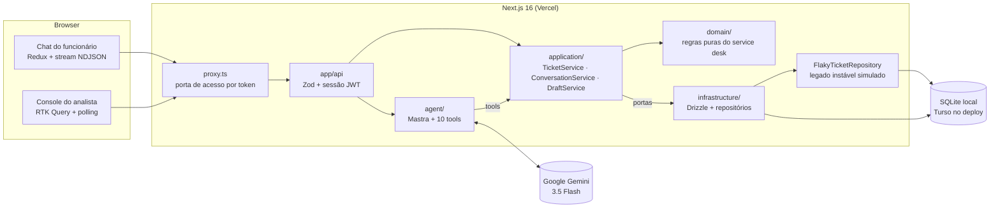
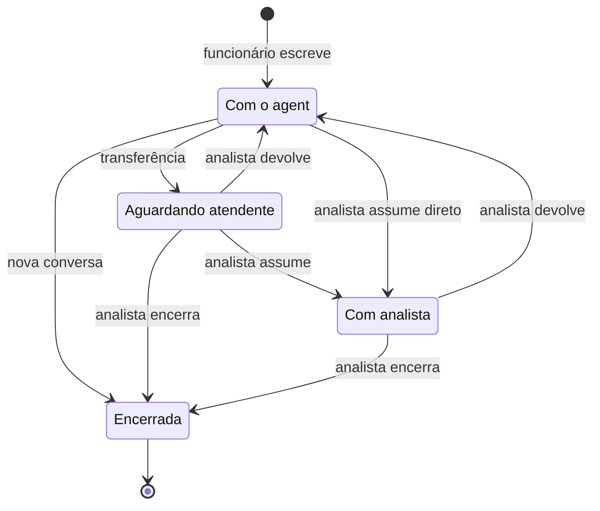
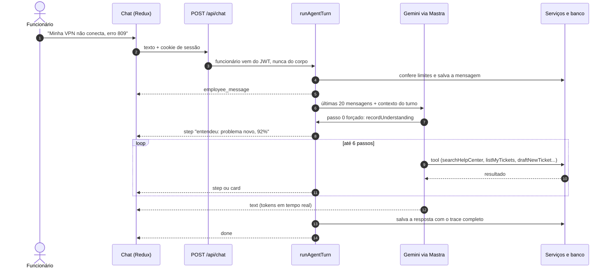
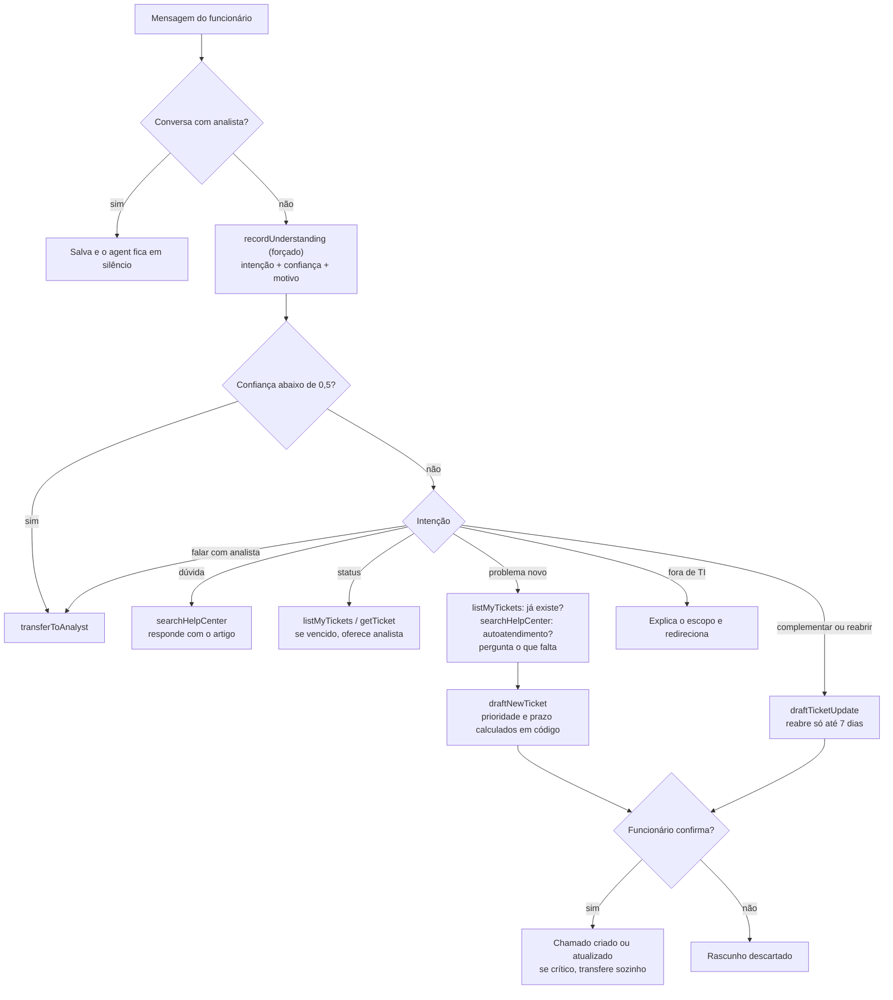
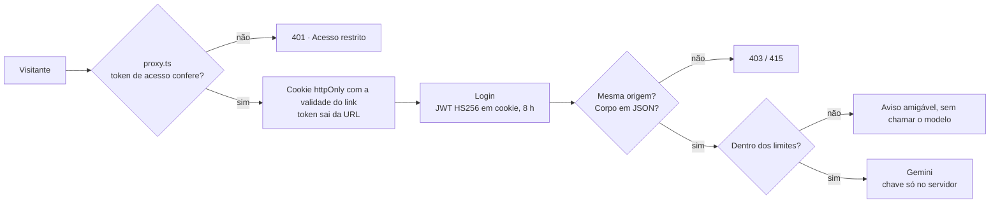

# Nexo Assist

Agent de atendimento do service desk de TI da Nexo. O funcionário descreve o problema com as próprias palavras. O agent consulta os chamados dele, busca na central de ajuda, abre ou atualiza chamados (sempre com confirmação) e chama um analista quando precisa. O analista atende pelo console: vê a fila, assume a conversa com o agent pausado e depois devolve ou encerra.

Cada resposta do agent mostra **o que ele entendeu, o que fez e por quê**: passos ao vivo, decisão com confiança, chamadas de tool com entrada e saída, regras que agiram, tokens e latência.

**Stack:** TypeScript estrito · Next.js 16 (App Router) · Mastra (agent) · Google Gemini 3.5 Flash · Drizzle + libSQL (SQLite local, Turso no deploy) · Redux Toolkit + RTK Query · Zod · shadcn/ui + Tailwind · Vitest · Playwright.

https://github.com/user-attachments/assets/e437ac0a-2016-430a-9259-805e0c0748a8

**Demonstração (1:49):** login, dúvida resolvida pela central de ajuda, o painel "por quê?", abertura de chamado conversando e com confirmação, chamado vencido indo para um analista e o console do analista. É uma gravação real com o Gemini; as esperas pelo modelo aparecem aceleradas e sinalizadas no vídeo.

---

## Sumário

1. [Como rodar](#como-rodar)
2. [Arquitetura](#arquitetura)
3. [Como o agent decide](#como-o-agent-decide)
4. [Como garanti a qualidade das decisões](#como-garanti-a-qualidade-das-decisões)
5. [Escolha do modelo](#escolha-do-modelo)
6. [Deploy e segurança](#deploy-e-segurança)
7. [Trade-offs](#trade-offs)
8. [O que eu faria com mais tempo](#o-que-eu-faria-com-mais-tempo)

---

## Como rodar

Pré-requisitos: Node 22+ e uma chave do Gemini ([Google AI Studio](https://aistudio.google.com/apikey)).

```bash
npm install
cp .env.example .env          # preencha GOOGLE_GENERATIVE_AI_API_KEY
npm run db:setup              # cria o banco local (local.db) com os dados de exemplo
npm run dev                   # http://localhost:3000
```

Qualquer senha funciona para os usuários de exemplo (regra do desafio). Na tela de login há botões de acesso rápido.

| Quem | E-mail | O que dá para ver |
|---|---|---|
| Ana Souza (funcionária) | `ana.souza@nexo.com.br` | 3 chamados abertos, 1 vencido (INC-20311), 1 resolvido há 4 dias (pode reabrir) |
| Elisa Prado (funcionária) | `elisa.prado@nexo.com.br` | conversa em andamento com o agent |
| Rafael Lima (analista N2) | `rafael.lima@nexo.com.br` | console com 2 conversas na fila |

Outros comandos:

```bash
npm test              # 135 testes unitários (domínio, serviços, HTTP, benchmark) — sem LLM
npm run test:e2e      # Playwright contra o build de produção — sem LLM
npm run eval          # 12 cenários de decisão do agent com o modelo real
npm run db:seed       # volta os dados ao estado inicial
npm run access-link   # link temporário para o deploy (5 min; `-- 60` para 60 min)
npm run typecheck && npm run lint
```

Todas as variáveis estão documentadas em [`.env.example`](.env.example) e são validadas com Zod em [`src/config/env.ts`](src/config/env.ts), o único arquivo que lê `process.env`.

---

## Arquitetura



```
src/
├── domain/           Regras puras do service desk (sem banco, sem rede, sem framework)
├── application/      Casos de uso: serviços de chamados, conversas e rascunhos + portas (interfaces)
├── infrastructure/   Banco (Drizzle), repositórios, legado instável simulado, composição
├── agent/            Agent Mastra: instruções, tools, orquestração de um turno
├── server/           Sessão (JWT em cookie), porta de acesso, helpers HTTP, montagem das respostas
├── contracts/        Tipos e schemas Zod compartilhados entre servidor e browser
├── app/              Páginas e rotas do Next.js (finas: validam, chamam um serviço, respondem)
├── features/         Telas: chat (slice Redux + stream), console (RTK Query), login
└── components/       UI compartilhada: mensagens, cards, trace, shadcn/ui
```

**Dependências só apontam para dentro** (`app → agent/application → domain`). O domínio não conhece Next, Mastra nem banco, por isso prioridade, prazo, reabertura e transições são testados sem mock. A aplicação depende de **portas** ([`application/ports.ts`](src/application/ports.ts)), que a infraestrutura implementa. Um único arquivo liga as peças: [`infrastructure/container.ts`](src/infrastructure/container.ts).

**O serviço de chamados é separado do agent.** O agent não toca no banco. As tools chamam o `TicketService`, que é o mesmo serviço usado pelas rotas e pelos botões. O "sistema legado" é um *decorator* (`FlakyTicketRepository`) que falha aleatoriamente (`LEGACY_FAILURE_RATE`, 15% por padrão). O serviço tenta de novo com backoff, e cada nova tentativa aparece no trace como "sistema de chamados instável".

**Persistência.** Conversas, mensagens (com cards e trace), rascunhos, chamados e o estado de cada conversa ficam no SQLite/Turso e sobrevivem a um restart. Ao voltar outro dia, o funcionário cai na conversa aberta dele.

**Tempo real.** `POST /api/chat` responde em NDJSON (um evento JSON por linha): `employee_message`, `step`, `card`, `text` (tokens) e `done`. O thunk do Redux lê o stream e despacha cada evento. As mensagens do analista chegam por polling a cada 4 s, o que basta para a escala do desafio e não exige WebSocket na Vercel.

### Estados da conversa

O agent só responde em **Com o agent**. Nos outros estados a mensagem é salva e ele fica em silêncio. As transições ficam numa tabela em [`domain/conversation.ts`](src/domain/conversation.ts), e o banco só aceita a mudança se o estado ainda for o esperado (update condicional), então analista e agent não se atropelam.



A transferência acontece por quatro motivos: o funcionário pediu, caso crítico, chamado com prazo vencido ou confiança do agent abaixo de 50%.

---

## Como o agent decide

Cada mensagem do funcionário vira um **turno** ([`agent/run-turn.ts`](src/agent/run-turn.ts)):



1. **Limites:** 30 mensagens por sessão, 40 por hora e 120 por dia por pessoa, e um teto global diário (proteção de custo).
2. **Pausa:** se a conversa está com um analista, a mensagem é salva e o modelo não é chamado.
3. **Entendimento obrigatório:** o primeiro passo do modelo é *forçado* (`prepareStep` + `toolChoice`) a chamar `recordUnderstanding` com a intenção, o que entendeu, a confiança (0–1) e o motivo. É daí que sai o painel "por quê?" de cada resposta.
4. **Ação:** o modelo escolhe as tools pela intenção, no máximo 6 passos.
5. **Registro:** a resposta é salva com o trace completo: decisão, passos visíveis, chamadas de tool cruas (entrada, saída, tempo), regras do sistema que agiram, modelo, tokens e latência.



### O que é garantido em código (não depende do prompt)

O modelo decide **o que fazer**. As regras do service desk ficam em código testado, para que um prompt mal interpretado não quebre uma regra.

| Regra (Anexo A) | Onde |
|---|---|
| Prioridade = impacto × urgência (o modelo informa os dois, o código calcula) | [`domain/priority.ts`](src/domain/priority.ts) |
| Prazo em horas/dias úteis (seg–sex, 8h–18h; crítico 1h corrida) | [`domain/business-time.ts`](src/domain/business-time.ts) |
| Só cria/atualiza depois da confirmação. O agent monta rascunho; `confirmDraft` só aceita rascunho mostrado num turno anterior da mesma conversa, e a confirmação é atômica (clique duplo não cria dois chamados) | [`application/draft-service.ts`](src/application/draft-service.ts) |
| Sem duplicidade: antes do rascunho, procura chamado aberto ou resolvido há até 7 dias da mesma categoria | `TicketService.findPossibleDuplicates` |
| Reabrir só até 7 dias | [`domain/ticket.ts`](src/domain/ticket.ts) (`canReopen`) |
| Confiança abaixo de 50% → transfere sozinho | [`agent/tools/understanding.ts`](src/agent/tools/understanding.ts) |
| Chamado crítico confirmado → transfere sozinho | `DraftService.confirm` |
| Agent mudo com analista; depois de transferir, não chama mais tools | `run-turn.ts` (`agentCanReply`, `toolChoice: "none"`) |
| Privacidade: o funcionário vem do cookie assinado, nunca de argumento do modelo; chamado de outra pessoa responde "não encontrado" | [`agent/turn-context.ts`](src/agent/turn-context.ts), `TicketService.getMine` |

O prompt ([`agent/instructions.ts`](src/agent/instructions.ts)) cuida só da conversa: perguntar uma coisa por vez, oferecer respostas rápidas, não repetir o que o card já mostra e redirecionar o que não é de TI.

---

## Como garanti a qualidade das decisões

| Camada | O que cobre | Comando |
|---|---|---|
| **Testes unitários** (Vitest, 135) | prazos com fim de semana, matriz de prioridade, máquina de estados, privacidade, reabertura, duplicidade, retry do legado, confirmação obrigatória, clique duplo, transferência em caso crítico, bloqueio de CSRF | `npm test` |
| **E2E** (Playwright, 11) | login (inclusive o botão de demonstração que entra com um clique), permissões (funcionário não acessa o console nem a API do analista) e o ciclo da transferência de ponta a ponta, contra o build de produção | `npm run test:e2e` |
| **Evals** (12 cenários, modelo real) | intenção, tools esperadas e proibidas, transferência, caso crítico, reabertura e vazamento de dados de outra pessoa | `npm run eval` |
| **Trace em toda resposta** | qualquer decisão pode ser auditada na própria interface e no console do analista | — |

O [CI](.github/workflows/ci.yml) roda tipos, lint, testes unitários e E2E em todo push e pull request, sem segredos. Os evals ficam fora porque chamam o modelo real e precisam de chave.

Os evals já pagaram o próprio custo. Um deles pegou o agent abrindo rascunho novo para um problema que já tinha chamado aberto; o ajuste nas instruções (consultar `listMyTickets` antes) levou o resultado a 10/10. Outro mostrou 10,8 s de latência por causa do "raciocínio" do Gemini; com `thinkingLevel: "minimal"` a latência caiu e os 10 cenários continuaram passando. Depois, o [benchmark](#benchmark-de-modelos) achou um defeito que nenhum modelo resolvia, porque estava no prompt: reabrir chamado resolvido. A regra foi para o código e virou um cenário novo, assim como o caso crítico que vários modelos não tratavam: hoje são 12/12.

O processo de desenvolvimento (SDD, TDD, skills, MCPs e uso de IA) está em [`docs/PROCESSO-IA.md`](docs/PROCESSO-IA.md), e as especificações em [`docs/specs/`](docs/specs).

---

## Escolha do modelo

**Gemini 3.5 Flash** (`google/gemini-3.5-flash`):

- **Tool calling confiável**, inclusive a escolha forçada de tool no primeiro passo, que é a base da transparência.
- **Latência baixa** com `thinkingLevel: "minimal"`: atendimento precisa de resposta rápida, não de raciocínio longo.
- **Custo de frações de centavo por conversa**, o que permite um deploy aberto para avaliação sem risco de conta alta.

A troca de modelo é uma variável (`LLM_MODEL`), graças ao roteador de modelos do Mastra. Pelo OpenRouter, basta `LLM_MODEL=openrouter/<fornecedor>/<modelo>` com `OPENROUTER_API_KEY`. Os evals dizem se a troca piorou alguma decisão.

**Decisão atual e próximo passo.** O [benchmark](#benchmark-de-modelos) mostrou o **GPT-6 Luna** com a mesma efetividade e qualidade do Gemini 3.5 Flash (diferenças dentro dos intervalos de confiança) a um custo **26× menor**. Mantive o Gemini em produção por enquanto: a vantagem do Luna é de custo, não de qualidade, os intervalos de efetividade do Luna e do Flash Lite se sobrepõem, e trocar perto da entrega exigiria uma nova chave em produção. Com o prompt corrigido, o Luna já passa nos 12 cenários do `npm run eval` (uma rodada). O próximo passo é uma rodada de confirmação com repetições, Luna × Flash Lite, e a troca de uma linha (`LLM_MODEL`).

**Custo sob controle:** o histórico enviado ao modelo tem no máximo 20 mensagens (cada uma cortada em 1.500 caracteres) e os cards viram resumos curtos entre colchetes. Prioridade, prazo, duplicidade e busca na central são código e não gastam token. Temperatura 0.2, até 6 passos e até 800 tokens de saída por passo.

## Benchmark de modelos

Para trocar a escolha qualitativa por dados, `npm run benchmark` roda o agent de produção (`runAgentTurn`) com 7 modelos via OpenRouter. São os 10 cenários do eval, duas vezes, mais 4 cenários tirados do PRD. O benchmark mede efetividade (as mesmas checagens do eval), qualidade (G-Eval com 7 critérios derivados do PRD, inclusive a transparência do `recordUnderstanding`, e painel de 2 juízes de famílias que não concorrem), latência e custo real cobrado. Depois combina tudo num score com pesos 40/30/15/15. Relatório completo, com gráficos e trechos das conversas: [`docs/benchmark/RELATORIO.md`](docs/benchmark/RELATORIO.md).

| Modelo | Composto | Efetividade | Qualidade (1–5) | Latência p50 | Custo por 1.000 atendimentos |
|---|---|---|---|---|---|
| **GPT-6 Luna** | **0,867** | 88% | 4,73 | 5,7 s | **US$ 1,22** |
| Gemini 3.5 Flash Lite | 0,841 | **96%** | 4,67 | **5,5 s** | US$ 7,24 |
| DeepSeek V4.1 Flash | 0,795 | 88% | 4,69 | 7,3 s | US$ 4,94 |
| Mistral Small 4 | 0,787 | 75% | 4,44 | 6,2 s | US$ 1,31 |
| Gemini 3.5 Flash (atual) | 0,725 | 83% | 4,72 | 6,9 s | US$ 31,93 |
| Qwen3.8 Flash (sem raciocínio) | 0,686 | 67% | 4,65 | 15,5 s | US$ 1,13 |
| Gemini 3.8 Flash | 0,649 | 75% | **4,84** | 12,2 s | US$ 15,09 |

**Recomendação: GPT-6 Luna.** Tem a mesma efetividade e qualidade do modelo atual (dentro dos intervalos de confiança), é mais rápido e custa 26× menos. Fica em 1º em 81% de 10 mil combinações de pesos sorteadas. A alternativa sem trocar de fornecedor é o Gemini 3.5 Flash Lite. O `LLM_MODEL` padrão não mudou (veja [Escolha do modelo](#escolha-do-modelo)). O benchmark também revelou dois pontos do prompt que valem para qualquer modelo:
- **Reabrir chamado resolvido** (0 de 7 modelos passavam): **já corrigido**. A consulta de chamados agora devolve também os resolvidos há até 7 dias, e o cenário entrou no `npm run eval` (11/11 com o Gemini).
- **Agir em caso crítico para a empresa toda** (4 de 7 modelos não agiam): **já corrigido**. As instruções agora proíbem perguntar o que a mensagem já respondeu, e um caso crítico vai direto ao rascunho (ao confirmar, o sistema transfere). O cenário entrou no `npm run eval`. Com o GPT-6 Luna, que falhava, foi de 0/3 para 3/3.

Com o prompt corrigido, o `npm run eval` completo deu **12/12 tanto com o Gemini 3.5 Flash quanto com o GPT-6 Luna**.

**Engenharia de cache.** O briefing do turno passou a trazer a hora cheia, em vez dos minutos, e cada conversa vai ao OpenRouter com `session_id`. Assim o prefixo do prompt fica estável e as chamadas da conversa caem no mesmo provedor. Luna, Mistral e Qwen leem de 71% a 91% do prompt do cache, e o Luna paga US$ 1,22 em vez de US$ 2,48 por 1.000 atendimentos. Nos juízes, a parte fixa do prompt vem primeiro e a conversa por último, e um cache local por hash do pedido faz com que rodar de novo não custe nada. Pelo OpenRouter, os Gemini não fizeram cache (0%).

O estudo gastou US$ 1,80 dos US$ 2,00 de uma chave criada só para ele. A estimativa abaixo confere o custo e o crédito da chave sem gastar nada:

```bash
npm run benchmark -- --dry-run
```

`npm run benchmark` roda o que falta (precisa de `OPENROUTER_API_KEY`), e `npm run benchmark -- --report` regera o relatório e os gráficos a partir dos resultados gravados, sem chamar API.

---

## Deploy e segurança

O deploy roda na **Vercel** com o banco no **Turso** (libSQL, compatível com o SQLite local).

### Como fiz o deploy

**App no ar:** https://nexo-assist-puce.vercel.app. O acesso é por um link temporário (`/?access=…`), enviado junto com o repositório. Sem ele, ou depois que ele vence, toda página e toda API respondem 401.

1. Criei o projeto na Vercel e instalei o **Turso pelo Marketplace da Vercel**. A integração cria o banco e as variáveis `TURSO_DATABASE_URL` e `TURSO_AUTH_TOKEN` no projeto, e o `env.ts` aceita esses nomes.
   ```bash
   vercel integration add tursocloud --name nexo-assist --meta region=iad1 --billing-plan starter -e production -e preview --no-env-pull
   ```
2. Apliquei as migrations e os dados de exemplo no Turso a partir da minha máquina, com as variáveis de produção num arquivo dentro de `.vercel/`, ignorado pelo git e que o Next não lê (nunca em `.env.local` ou `.env.production.local`, que o Next carrega sozinho):
   ```bash
   vercel env pull .vercel/env.production --environment=production
   npx tsx --env-file=.vercel/env.production scripts/migrate.ts
   npx tsx --env-file=.vercel/env.production scripts/seed.ts
   ```
3. Configurei as variáveis, todas só no servidor:
   - `GOOGLE_GENERATIVE_AI_API_KEY` foi enviada com [`scripts/env-to-vercel.mjs`](scripts/env-to-vercel.mjs), que lê o `.env` e entrega o valor direto à CLI da Vercel, sem exibi-lo. É a mesma chave do desenvolvimento; uma chave exclusiva do deploy permitiria revogá-la sem afetar o ambiente local.
   - `AUTH_SECRET` e `ACCESS_TOKEN` foram gerados e enviados pela CLI por pipe, sem passar pela tela:
     ```bash
     node -e "process.stdout.write(require('crypto').randomBytes(36).toString('base64url'))" | vercel env add AUTH_SECRET production --sensitive
     ```
   - Completam a lista `LLM_MODEL`, `DAILY_AGENT_TURN_LIMIT` e `TOTAL_AGENT_TURN_LIMIT=100`.
4. Publiquei pela CLI (`vercel deploy --prod`) a partir de um `git archive` do último commit, para nunca subir arquivo que não está versionado. O [`.vercelignore`](.vercelignore) também barra `.env` e bancos locais.
5. As funções rodam em `iad1` (Washington), na mesma região do banco. A "Vercel Authentication" protege só os previews; a produção fica atrás do nosso token.

### Como protegi as chaves e limitei o uso



| Risco | Proteção |
|---|---|
| Qualquer pessoa usar o agent (e a minha cota) | **Porta de acesso com link temporário** em [`proxy.ts`](src/proxy.ts): sem `?access=` válido, nenhuma página ou API responde. O link leva `<validade>.<HMAC>`, assinado com o segredo `ACCESS_TOKEN`, que nunca sai do servidor ([`server/access-gate.ts`](src/server/access-gate.ts)). O token vira um cookie httpOnly que vence junto com o link e sai da URL. `npm run access-link -- <minutos>` gera um link novo. Se o `ACCESS_TOKEN` faltar na Vercel, a porta fecha em vez de abrir. |
| Vazamento de chave | Chaves só em variáveis de ambiente do servidor, validadas com Zod. Nada com prefixo `NEXT_PUBLIC_`. `.env` fora do git. |
| Custo inesperado | 30 mensagens por sessão, 40 por hora e 120 por dia por pessoa, teto global diário (`DAILY_AGENT_TURN_LIMIT`), **teto total de 100 turnos do modelo** (`TOTAL_AGENT_TURN_LIMIT`: cerca de US$ 1,06, ou R$ 6, pelo custo de US$ 0,0106 por resposta medido no benchmark), reservado no banco num único comando antes de chamar o modelo (pedidos simultâneos não passam do teto, e turno que falha também conta), 800 tokens de saída por passo, histórico truncado, e a chamada ao modelo é cancelada quando o funcionário fecha a aba. Recomendo também um limite de gasto no projeto do Google Cloud. |
| Requisição forjada de outro site (CSRF) | Toda mutação exige mesma origem (`Sec-Fetch-Site`/`Origin`) e corpo JSON ([`server/http.ts`](src/server/http.ts)). |
| Ação em nome de outra pessoa | A identidade vem só do JWT da sessão (algoritmo fixo HS256). O modelo nunca recebe nem informa id de funcionário. |
| Corridas (clique duplo, analista e agent ao mesmo tempo, rajada de mensagens) | Confirmação de rascunho atômica no banco e update de conversa condicionado ao estado esperado. Os limites por pessoa são conferidos de novo depois de gravar a mensagem. |
| Dados pessoais nos logs | Erro do banco é registrado só pela causa (ex.: `SQLITE_BUSY`), sem a consulta e seus parâmetros (texto do chat, e-mail). O corpo enviado ao LLM nunca é registrado. |
| Clickjacking e afins | CSP, `X-Frame-Options: DENY`, `nosniff`, `Referrer-Policy`, `Permissions-Policy` e sem `X-Powered-By` ([`next.config.ts`](next.config.ts)). |

Antes do deploy fiz uma auditoria de segurança do código inteiro; as correções estão no commit `fix(security): correções da auditoria de segurança`.

Depois do deploy, uma segunda revisão independente (código + 37 verificações de fora, contra produção: porta de acesso, CSRF, JWT adulterado, permissões, cabeçalhos, segredos no JS) achou sete pontos de severidade baixa a média. Corrigi seis no commit `fix(security): teto atômico, limites pós-gravação, logs sem dados e porta que fecha`: teto total que pedidos paralelos furavam, limites por pessoa com a mesma corrida, log de erro do banco com dados pessoais (e a detecção de número de chamado repetido, que nunca disparava), porta aberta se faltasse o segredo, `Content-Type` comparado por trecho e `Origin: null` dando erro 500, e o matcher do proxy sem âncora. O sétimo ficou como trade-off (abaixo).

---

## Trade-offs

- **Polling em vez de WebSocket/SSE** para as mensagens do analista: simples e compatível com serverless. O custo é uma latência de até 4 s.
- **Busca por palavras-chave** na central: com 9 artigos é grátis e explicável (o trace mostra os termos que bateram). Com centenas de artigos, eu trocaria por embeddings sem mudar quem chama.
- **Duplicidade por regra simples** (mesmo tipo, mesma categoria e palavra em comum no título), com a decisão final para o modelo: barato e transparente. Pode deixar passar um duplicado escrito com outras palavras; com mais tempo, seria similaridade de texto.
- **Histórico próprio em vez da memória do Mastra:** o console do analista lê e escreve na mesma conversa, então mantive uma única tabela `messages` como fonte da verdade.
- **Limites contados no próprio banco** em vez de Redis: um serviço a menos, consistente entre instâncias serverless, ao custo de duas consultas indexadas por mensagem.
- **Porta de acesso por link com token** em vez de contas para avaliadores: zero atrito para quem avalia e suficiente para proteger a cota. Para produção, seria SSO.
- **CSP sem nonce** (`'unsafe-inline'` em scripts): mantém as páginas estáticas e o deploy simples. Com nonce, a CSP fica mais rígida, mas toda página passa a ser dinâmica.
- **Login sem senha real**, como pede o desafio: a sessão é um JWT assinado em cookie httpOnly, então a troca para SSO corporativo fica isolada em [`server/session.ts`](src/server/session.ts).
- **Sair não revoga o JWT no servidor**: o botão apaga o cookie, mas um token copiado antes continua válido até vencer (8 horas, ou 7 dias com "Manter conectado"). Revogar exigiria uma lista no banco consultada a cada pedido, e na demonstração os avaliadores entram todos como a mesma Ana: revogar por pessoa derrubaria os outros. Com SSO, a sessão passa a ser do provedor.

## O que eu faria com mais tempo

- Eventos em tempo real (SSE) para o console e o chat do analista.
- Busca semântica na central e detecção de duplicidade por similaridade de texto.
- Evals no CI com limiar mínimo e histórico de resultados por versão do prompt.
- Rate limit por IP na borda (Vercel Firewall) além dos limites por pessoa.
- Observabilidade: traces do Mastra exportados via OpenTelemetry e painel de métricas (resolução sem fila, tempo até a primeira resposta, motivos de transferência).
- SSO corporativo e CSP com nonce.

## Documentação

- [`docs/specs/`](docs/specs): especificações (SDD) de regras, agent, conversa/console e arquitetura.
- [`docs/PROCESSO-IA.md`](docs/PROCESSO-IA.md): como IA, MCPs, skills, TDD e SDD foram usados.
- [`AGENTS.md`](AGENTS.md) e [`.claude/skills/`](.claude/skills): convenções e roteiros para quem (ou qual IA) for alterar o projeto.
