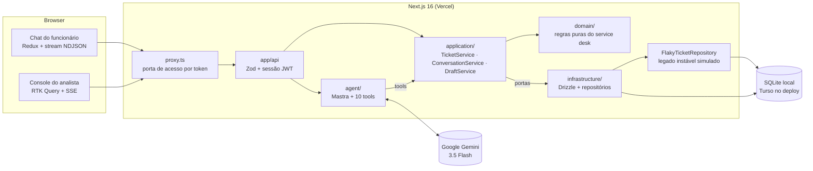
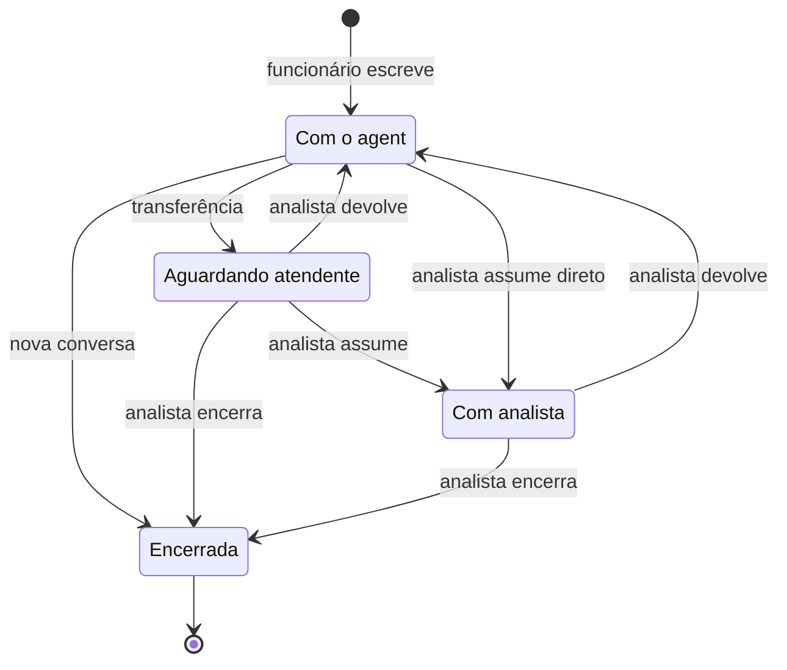
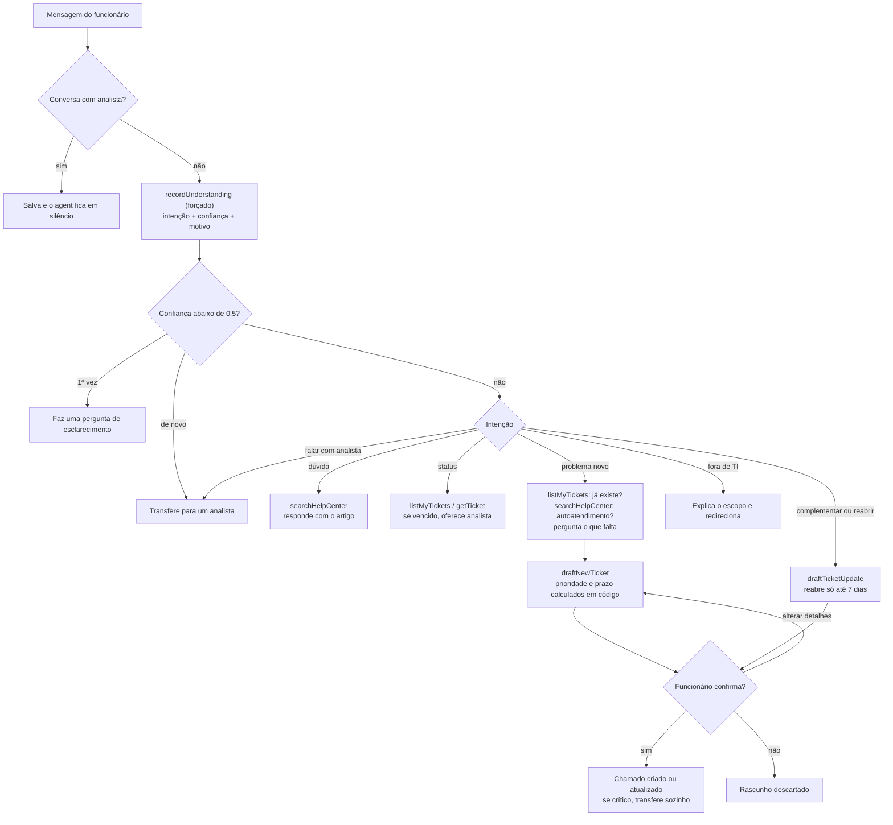

# Nexo Assist

Agent de atendimento do service desk de TI da Nexo. O funcionário descreve o problema com as próprias palavras. O agent consulta os chamados dele, busca na central de ajuda, abre ou atualiza chamados (sempre com confirmação) e chama um analista quando precisa. O analista atende pelo console: vê a fila, assume a conversa com o agent pausado e depois devolve ou encerra.

Cada resposta do agent mostra **o que ele entendeu, o que fez e por quê**: passos ao vivo, decisão com confiança, chamadas de tool com entrada e saída, regras que agiram, tokens e latência.

**Stack:** TypeScript estrito · Next.js 16 (App Router) · Mastra (agent) · Google Gemini 3.5 Flash · Drizzle + libSQL (SQLite local, Turso no deploy) · Redux Toolkit + RTK Query · Zod · shadcn/ui + Tailwind · Vitest · Playwright.

https://github.com/user-attachments/assets/b8169f56-3f1e-414a-aadd-0796184bf93b

**Demonstração (1:49):** login, dúvida resolvida pela central de ajuda, o painel "por quê?", abertura de chamado conversando e com confirmação, chamado vencido indo para um analista e o console do analista. É uma gravação real com o Gemini; as esperas pelo modelo aparecem aceleradas e sinalizadas no vídeo.

**App no ar:** https://nexo-assist-puce.vercel.app, com um link de acesso temporário enviado junto com o repositório.

### Comece por aqui (3 minutos)

1. **Veja o agent decidir:** o [roteiro de 3 minutos](#roteiro-de-3-minutos) no app, com o painel "por quê?" em cada resposta.
2. **Veja o que é regra em código, não prompt:** a tabela [O que é garantido em código](#o-que-é-garantido-em-código-não-depende-do-prompt).
3. **Veja as provas:** [`docs/validacao/`](docs/validacao/README.md). Cada melhoria tem pergunta, método, números e limites:
   - busca: 84% → 94%;
   - tempo real: ~1,6 s → ~0,4 s;
   - red-team: 21/21, mapeado ao OWASP.
4. **Rode tudo sem LLM:** `npm run verify` (tipos, lint, 289 testes unitários e 39 E2E).
5. **Por que existe cada peça:** a [pesquisa de fronteira](docs/pesquisa/FRONTEIRA.md), com o que ServiceNow, Zendesk, Intercom e Atlassian fazem, e o que virou código aqui.

---

## Sumário

1. [Como rodar](#como-rodar) · [Roteiro de 3 minutos](#roteiro-de-3-minutos)
2. [Arquitetura](#arquitetura)
3. [Como o agent decide](#como-o-agent-decide)
4. [Como garanti a qualidade das decisões](#como-garanti-a-qualidade-das-decisões)
5. [Escolha do modelo](#escolha-do-modelo)
6. [Deploy e segurança](#deploy-e-segurança)
7. [Trade-offs](#trade-offs)
8. [O que eu faria com mais tempo](#o-que-eu-faria-com-mais-tempo)

---

## Como rodar

Pré-requisitos: Node 22.9+ e uma chave do Gemini ([Google AI Studio](https://aistudio.google.com/apikey)).

```bash
npm install
cp .env.example .env          # preencha GOOGLE_GENERATIVE_AI_API_KEY (no cmd.exe: copy)
npm run db:setup              # cria o banco local (local.db) com os dados de exemplo
npm run dev                   # http://localhost:3000 (outra porta: npm run dev -- -p 3001)
```

Ou com Docker, sem instalar Node: `docker build -t nexo-assist . && docker run --rm -p 127.0.0.1:3000:3000 -e AUTH_SECRET=SEGREDO_COM_32_OU_MAIS_CARACTERES -e GOOGLE_GENERATIVE_AI_API_KEY=SUA_CHAVE -v nexo-data:/data nexo-assist` (o banco fica no volume e recebe os dados de exemplo no primeiro start; gere o segredo com o comando do `.env.example` e abra http://localhost:3000 no Chrome, Edge ou Firefox).

Sem a chave, o login, o console do analista e os testes funcionam; o chat avisa que falta configurar `GOOGLE_GENERATIVE_AI_API_KEY`.

Qualquer senha funciona para os usuários de exemplo (regra do desafio). Na tela de login há botões de acesso rápido.

| Quem | E-mail | O que dá para ver |
|---|---|---|
| Ana Souza (funcionária) | `ana.souza@nexo.com.br` | 3 chamados abertos, 1 vencido (INC-20311), 1 resolvido há 4 dias (pode reabrir) |
| Elisa Prado (funcionária) | `elisa.prado@nexo.com.br` | conversa em andamento com o agent |
| Rafael Lima (analista N2) | `rafael.lima@nexo.com.br` | console com 2 conversas na fila |

Outros comandos:

```bash
npm test                          # 289 testes unitários — sem LLM
npx playwright install chromium   # só na primeira vez, antes do E2E
npm run test:e2e                  # 39 testes E2E contra o build de produção — sem LLM
npm run eval                      # 26 cenários de decisão do agent com o modelo real (8 de ataque)
npm run eval:sim                  # funcionário simulado por um modelo, pass^k (τ-bench)
npm run eval:busca                # busca na central: palavras-chave × híbrida, 50 perguntas
npm run eval:sugestao             # sugestão de resposta do analista com o modelo real
npm run otel:local                # coletor OTLP local para ver a telemetria dos turnos
npm run db:seed                   # volta os dados ao estado inicial
npm run typecheck && npm run lint
```

Para rodar o build local (`npm run build && npm start`), preencha também `AUTH_SECRET` no `.env` (o comando para gerar está no [`.env.example`](.env.example)). Todas as variáveis estão documentadas ali e são validadas com Zod em [`src/config/env.ts`](src/config/env.ts); só ele e o [`proxy.ts`](src/proxy.ts) (porta de acesso) leem `process.env` na aplicação.

### Roteiro de 3 minutos

Entre como **Ana** e escreva:

1. **"Qual o horário do service desk?"** → responde pela central de ajuda. Clique em **"por quê?"** para ver a intenção, a confiança, as tools e as regras.
2. **"Como está o chamado do notebook?"** → encontra o INC-20311 sem o número, mostra que o prazo venceu e oferece um analista.
3. **"Minha VPN dá erro 809, uso Windows 11"** → o artigo vale só para Windows 10, então ele pergunta o que falta e monta um **rascunho**. Use **"Alterar detalhes"** (a prioridade e o prazo mudam ao vivo) e **Confirmar**.
4. **"Quero falar com um analista"** → a conversa vai para a fila. Entre como **Rafael**: abra o **Relatório** da conversa (o que a pessoa precisa, o que o agent já fez e o que está pendente), assuma, use **"Sugerir resposta"** (o modelo escreve, você revisa) e devolva ao agent. A mensagem chega ao chat da Ana em menos de 1 s (SSE).
5. Ainda como **Rafael**, repare na fila: o chip **"Frustração alta"** da Carla e o aviso de **possível incidente em massa** (três pessoas com o sistema de ponto fora do ar). Pela regra, o aviso dura 4 horas úteis depois do seed; para vê-lo de novo, rode `npm run db:seed`. Em **Indicadores**: a resolução honesta (confirmada × presumida, sem contar chamado aberto nem quem voltou com o mesmo problema), as lacunas da central e os prazos em risco com a conta explicada.

---

## Arquitetura



```
src/
├── domain/           Regras puras do service desk (sem banco, sem rede, sem framework)
├── application/      Casos de uso: serviços de chamados, conversas e rascunhos + portas (interfaces)
├── infrastructure/   Banco (Drizzle), repositórios, legado instável simulado, composição
├── agent/            Agent Mastra: instruções, tools, orquestração de um turno
├── server/           Sessão (JWT em cookie), porta de acesso, helpers HTTP, montagem das respostas
├── contracts/        Tipos e schemas Zod compartilhados entre servidor e browser
├── app/              Páginas e rotas do Next.js (finas: validam, chamam um serviço, respondem)
├── features/         Telas: chat (slice Redux + stream), console (RTK Query), login
└── components/       UI compartilhada: mensagens, cards, trace, shadcn/ui
```

- **Dependências só apontam para dentro** (`app → agent/application → domain`). O domínio não conhece Next, Mastra nem banco, então prioridade, prazo, reabertura e transições são testados sem mock. A aplicação depende de **portas** ([`application/ports.ts`](src/application/ports.ts)); um único arquivo liga as peças: [`infrastructure/container.ts`](src/infrastructure/container.ts).
- **O serviço de chamados é separado do agent.** As tools chamam o `TicketService`, o mesmo das rotas e dos botões. O "sistema legado" é um *decorator* (`FlakyTicketRepository`) que falha aleatoriamente (`LEGACY_FAILURE_RATE`, 15%). O serviço tenta de novo, e cada nova tentativa aparece no trace. Se a falha vier depois de o chamado ser gravado, nada é desfeito, para o próximo Confirmar não duplicar.
- **Persistência:** conversas, mensagens (com cards e trace), rascunhos, chamados e o estado de cada conversa ficam no SQLite/Turso e sobrevivem a um restart. Ao voltar outro dia, o funcionário cai na conversa aberta dele.
- **Tempo real:** `POST /api/chat` responde em NDJSON (`employee_message`, `step`, `card`, `text`, `done`), e o thunk do Redux despacha cada evento. O console e o chat (enquanto um analista atende) abrem um stream SSE. O servidor confere uma assinatura barata do banco a cada 1 s e avisa "mudou"; a tela busca de novo pelas rotas de sempre. A mensagem chega em ~0,3–0,6 s de mediana, contra ~1,6 s no polling antigo, que continua como plano B ([medição](docs/validacao/TEMPO-REAL.md)).

### Estados da conversa

O agent só responde em **Com o agent**. Nos outros estados a mensagem é salva e ele fica em silêncio. As transições ficam numa tabela em [`domain/conversation.ts`](src/domain/conversation.ts), e o banco só aceita a mudança se o estado ainda for o esperado, então analista e agent não se atropelam.



A transferência acontece por quatro motivos: o funcionário pediu, caso crítico, chamado com prazo vencido ou o agent sem segurança mesmo depois de perguntar.

---

## Como o agent decide

Cada mensagem do funcionário vira um **turno** ([`agent/run-turn.ts`](src/agent/run-turn.ts)):

1. **Limites:** 30 mensagens por sessão, 40 por hora e 120 por dia por pessoa, teto diário global e teto total (proteção de custo).
2. **Pausa:** se a conversa está com um analista, a mensagem é salva e o modelo não é chamado.
3. **Entendimento obrigatório:** o primeiro passo do modelo é *forçado* (`prepareStep` + `toolChoice`) a chamar `recordUnderstanding` com a intenção, o que entendeu, a confiança (0–1) e o motivo. É daí que sai o painel "por quê?".
4. **Ação:** o modelo escolhe as tools pela intenção, em até 6 passos, com as últimas 20 mensagens como contexto.
5. **Registro:** a resposta é salva com o trace completo (decisão, passos, chamadas de tool, regras que agiram, modelo, tokens e latência) e chega ao chat em tempo real.



### O que é garantido em código (não depende do prompt)

O modelo decide **o que fazer**. As regras do service desk ficam em código testado, para que um prompt mal interpretado não quebre uma regra.

| Regra (Anexo A) | Onde |
|---|---|
| Prioridade = impacto × urgência (o modelo informa os dois, o código calcula) | [`domain/priority.ts`](src/domain/priority.ts) |
| Prazo em horas/dias úteis (seg–sex, 8h–18h; crítico 1h corrida) | [`domain/business-time.ts`](src/domain/business-time.ts) |
| Só cria/atualiza depois da confirmação; `confirmDraft` só aceita rascunho já mostrado, e a confirmação é atômica (clique duplo não cria dois chamados) | [`application/draft-service.ts`](src/application/draft-service.ts) |
| Sem duplicidade: procura chamado aberto ou resolvido há até 7 dias do mesmo tipo, categoria e com palavra relevante em comum no título | `TicketService.findPossibleDuplicates` |
| "Alterar detalhes" no card: o servidor recalcula a prioridade (nunca a do navegador) e confere a duplicidade de novo, sem chamar o modelo | [`domain/draft-revision.ts`](src/domain/draft-revision.ts) |
| Reabrir só até 7 dias | [`domain/ticket.ts`](src/domain/ticket.ts) (`canReopen`) |
| Sem segurança: pergunta uma vez; se continuar, transfere sozinho | [`domain/conversation.ts`](src/domain/conversation.ts) (`shouldHandOffForLowConfidence`) |
| Chamado crítico confirmado → transfere sozinho | `DraftService.confirm` |
| Agent mudo com analista; depois de transferir, não chama mais tools | `run-turn.ts` (`agentCanReply`), [`agent/step-policy.ts`](src/agent/step-policy.ts) |
| Relatório da conversa para o analista: montado do histórico e dos traces, sem chamar o modelo (não inventa nem gasta o teto) | [`domain/conversation-report.ts`](src/domain/conversation-report.ts) |
| Incidente em massa: 3+ outras pessoas com o mesmo problema nas últimas 4 h úteis → impacto sobe para "equipe" e a prioridade é recalculada, sem revelar quem relatou | [`domain/known-issue.ts`](src/domain/known-issue.ts) |
| Frustração alta (ou moderada duas vezes) → o botão "Falar com um analista" aparece; nunca transfere sozinho nem mexe na prioridade | [`domain/frustration.ts`](src/domain/frustration.ts), `run-turn.ts` |
| Busca na central: híbrida (sentido + palavras), abstém quando o 1º não se destaca do 2º; sem chave, só palavras | [`domain/hybrid-search.ts`](src/domain/hybrid-search.ts) |
| Aviso de prazo em risco (75% do prazo útil) com a conta explicada | [`domain/sla-risk.ts`](src/domain/sla-risk.ts) |
| Modelo reserva: se o Gemini 3.5 Flash falhar (ex.: 503), o passo vai para o Flash Lite e o trace diz quem respondeu; o custo usa o preço de quem respondeu | [`agent/model-fallback.ts`](src/agent/model-fallback.ts) |
| Entendimento registrado uma vez por turno: chamadas paralelas repetidas não transferem nem avisam de novo | [`agent/turn-context.ts`](src/agent/turn-context.ts) (`recordDecision`) |
| Privacidade: o funcionário vem do cookie assinado, nunca de argumento do modelo; chamado de outra pessoa responde "não encontrado" | [`agent/turn-context.ts`](src/agent/turn-context.ts), `TicketService.getMine` |

O [`step-policy.ts`](src/agent/step-policy.ts) segue o padrão *action-selector* da literatura de defesa contra injeção ([arXiv 2506.08837](https://arxiv.org/abs/2506.08837)): o código decide quais tools existem em cada passo, e o modelo só escolhe entre elas. Um texto malicioso pode mudar o que o modelo *quer* fazer, mas não o que ele *consegue* fazer.

O prompt ([`agent/instructions.ts`](src/agent/instructions.ts)) cuida só da conversa: perguntar uma coisa por vez, não perguntar o que a mensagem já disse, oferecer respostas rápidas e redirecionar o que não é de TI (falha técnica em sistema de outra área continua sendo TI).

---

## Como garanti a qualidade das decisões

| Camada | O que cobre | Comando |
|---|---|---|
| **Testes unitários** (Vitest, 289) | prazos com fim de semana, matriz de prioridade, máquina de estados, privacidade, reabertura, duplicidade, retry do legado sem duplicar, confirmação obrigatória, clique duplo, alteração de rascunho, transferência por baixa confiança e em caso crítico, CSRF, teto atômico contra SQLite real, incidente em massa, frustração, resolução honesta, lacunas da central com mascaramento, OIDC contra tokens forjados, modelo reserva e o estimador pass^k | `npm test` |
| **E2E** (Playwright, 39) | login (inclusive SSO contra um provedor OIDC falso), permissões, transferência de ponta a ponta, relatório, sugestão de resposta, indicadores, prazos em risco, incidente em massa, frustração, tempo real com latência medida, estados de erro e a página 404, contra o build de produção | `npm run test:e2e` |
| **Evals** (26 cenários, modelo real) | intenção, tools esperadas e proibidas, transferência (e quando *não* transferir), caso crítico, reabertura, escopo de TI, vazamento de dados, incidente em massa, frustração e 8 ataques mapeados ao OWASP ([red-team](docs/validacao/RED-TEAM.md)) | `npm run eval` |
| **Funcionário simulado** (pass^k) | um modelo faz o papel do funcionário, com fatos que só conta se perguntarem, e clica em Confirmar ou Descartar; o estado no banco é conferido em k execuções | `npm run eval:sim` |
| **Provas de eficácia** | busca híbrida 84% → 94% ([BUSCA](docs/validacao/BUSCA.md)); tempo real ~0,4 s × ~1,6 s ([TEMPO-REAL](docs/validacao/TEMPO-REAL.md)); telemetria e SSO ([OBSERVABILIDADE-E-SSO](docs/validacao/OBSERVABILIDADE-E-SSO.md)) | `docs/validacao/` |
| **Trace em toda resposta** | qualquer decisão pode ser auditada na própria interface e no console do analista | — |

O CI está configurado no [CircleCI](.circleci/config.yml) para cada push: tipos, lint, testes unitários, E2E e o build da imagem Docker com uma prova de fumaça (migra, cria os dados de exemplo, faz login e reinicia sem perder dados), sem segredos do app nem chave de LLM. Os evals ficam fora porque chamam o modelo real.

Localmente, `npm run verify` roda tipos, lint, testes e E2E antes de cada push.

Os evals pagaram o próprio custo: pegaram o agent abrindo chamado repetido, a latência do "raciocínio" do Gemini (resolvida com `thinkingLevel: "minimal"`), a reabertura de chamado resolvido e o caso crítico que ele não tratava. Uma auditoria com conversas difíceis achou mais dois: mensagem vaga ia direto para um analista, e falha técnica num sistema do RH era recusada como "fora de TI". Cada achado virou regra e cenário novo.

O processo de desenvolvimento (SDD, TDD, skills, MCPs e uso de IA) está em [`docs/PROCESSO-IA.md`](docs/PROCESSO-IA.md), e as especificações em [`docs/specs/`](docs/specs).

---

## Escolha do modelo

**Gemini 3.5 Flash** (`google/gemini-3.5-flash`):

- **Tool calling confiável**, inclusive a escolha forçada de tool no primeiro passo, que é a base da transparência.
- **Latência baixa** com `thinkingLevel: "minimal"`: atendimento precisa de resposta rápida, não de raciocínio longo.
- **Cerca de 1 centavo de dólar por resposta**, o que permite um deploy aberto para avaliação com custo previsível.

**Modelo reserva:** quando o Flash falha (no dia 28/10/2026 ele passou mais de uma hora devolvendo 503 "alta demanda" nas chamadas com tools), o passo vai para o **Gemini 3.5 Flash Lite** (`LLM_FALLBACK_MODEL`). O trace mostra quem respondeu, e os evals contam esses turnos à parte para não confundir a medição. O reserva é do mesmo fornecedor: para resistir a uma queda do Google inteiro, basta apontar `LLM_FALLBACK_MODEL` para um modelo do OpenRouter, com a chave dele.

Trocar de modelo é uma variável (`LLM_MODEL`), graças ao roteador do Mastra; pelo OpenRouter, `LLM_MODEL=openrouter/<fornecedor>/<modelo>` com `OPENROUTER_API_KEY`. Os evals dizem se a troca piorou alguma decisão.

**Benchmark.** Para trocar a escolha qualitativa por dados, rodei o agent de produção com 7 modelos (efetividade, qualidade por G-Eval com 2 juízes, latência e custo real). O **GPT-6 Luna** empatou em efetividade e qualidade com o Gemini 3.5 Flash, dentro dos intervalos de confiança, custando **26× menos**; o Gemini 3.5 Flash Lite é a alternativa sem trocar de fornecedor. Mantive o Gemini em produção porque a vantagem é de custo, não de qualidade, e trocar perto da entrega exigiria outra chave. O próximo passo é uma rodada de confirmação Luna × Flash Lite e a troca de uma linha. Relatório completo: [`docs/benchmark/RELATORIO.md`](docs/benchmark/RELATORIO.md); como rodar: [`docs/benchmark/COMO-RODAR.md`](docs/benchmark/COMO-RODAR.md).

**Custo sob controle:** histórico de no máximo 20 mensagens (cada uma cortada em 1.500 caracteres), cards resumidos, prioridade, prazo, duplicidade e busca em código (sem token), temperatura 0.2, até 6 passos e 800 tokens de saída por passo.

---

## Deploy e segurança

O deploy roda na **Vercel** com o banco no **Turso**, publicado a partir de um `git archive` do último commit (nunca sobe arquivo fora do git). Os passos, os comandos e o histórico das revisões de segurança estão em [`docs/DEPLOY.md`](docs/DEPLOY.md).

| Risco | Proteção |
|---|---|
| Qualquer pessoa usar o agent (e a minha cota) | **Porta de acesso com link temporário** em [`proxy.ts`](src/proxy.ts): sem `?access=` válido, nenhuma página ou API responde (401). O link leva `<validade>.<HMAC>`, assinado com um segredo que nunca sai do servidor ([`server/access-gate.ts`](src/server/access-gate.ts)); vira um cookie httpOnly que vence junto e sai da URL. Sem o segredo na Vercel, a porta fecha. |
| Vazamento de chave | Chaves só em variáveis de ambiente do servidor, validadas com Zod. Nada com prefixo `NEXT_PUBLIC_`. `.env` fora do git; o JavaScript entregue foi conferido sem chaves. Se faltar a chave no deploy, o funcionário vê só "indisponível"; o nome da variável fica no log. |
| Custo inesperado | 30 mensagens por sessão, 40 por hora e 120 por dia por pessoa, **100 mensagens por dia no deploy inteiro** (`DAILY_AGENT_TURN_LIMIT`, janela de 24 horas) e **teto total de 1000 turnos** (`TOTAL_AGENT_TURN_LIMIT`, cerca de US$ 10,60), reservado no banco num único comando antes de chamar o modelo; 800 tokens por passo; a chamada é cancelada quando a aba fecha. Ao atingir o teto, o chat avisa e não chama o modelo. "Alterar detalhes" não chama o modelo, mas tem teto de 20 rascunhos por conversa. |
| Requisição forjada de outro site (CSRF) | Toda mutação exige mesma origem (`Sec-Fetch-Site`/`Origin`); as que têm corpo exigem JSON validado por Zod ([`server/http.ts`](src/server/http.ts)). |
| Ação em nome de outra pessoa | A identidade vem só do JWT da sessão (algoritmo fixo HS256). O modelo nunca recebe nem informa id de funcionário. |
| O modelo agir quando devia perguntar | As tools liberadas em cada passo são decididas em código ([`agent/step-policy.ts`](src/agent/step-policy.ts)): no turno de esclarecimento, só botões de resposta; depois de transferir, nenhuma. |
| Corridas | Confirmação de rascunho atômica, update de conversa condicionado ao estado esperado e limites conferidos de novo depois de gravar a mensagem. |
| Dados pessoais nos logs | Erro do banco é registrado só pela causa (ex.: `SQLITE_BUSY`), sem os parâmetros da consulta. O corpo enviado ao LLM nunca é registrado. |
| Dados pessoais na telemetria e nos indicadores | A telemetria OpenTelemetry/Langfuse é opcional e, por padrão, não leva texto da conversa nem argumentos de tools; o funcionário vira um pseudônimo. As frases de exemplo das lacunas da central mascaram e-mail, CPF, telefone e números. O incidente em massa não revela quem relatou. |
| Clickjacking e afins | CSP, `X-Frame-Options: DENY`, `nosniff`, `Referrer-Policy`, `Permissions-Policy`, HSTS e sem `X-Powered-By` ([`next.config.ts`](next.config.ts)). |

Houve quatro rodadas de revisão de segurança (antes do deploy, depois do deploy, uma com 42 verificações de fora contra produção e uma com skills de auditoria de terceiros); o detalhe está em [`docs/DEPLOY.md`](docs/DEPLOY.md).

---

## Trade-offs

- **SSE com conferência no servidor, não push de verdade:** a Vercel não tem fila compartilhada entre funções, então o stream confere uma assinatura do banco a cada 1 s. Isso dá menos de 1 s de latência, mas cada aba aberta faz uma consulta leve por segundo; com muitos analistas, o certo seria Redis pub/sub. O polling continua como plano B.
- **Busca híbrida com embeddings em cache no banco:** o acerto subiu de 84% para 94% nas 50 perguntas ([medição](docs/validacao/BUSCA.md)). Sem a chave, ou se o Gemini falhar, ela volta para as palavras-chave.
- **Duplicidade por regra simples** (mesmo tipo, categoria e palavra em comum no título), com a decisão final para o modelo: barato e transparente, mas pode deixar passar um duplicado escrito com outras palavras.
- **Histórico próprio em vez da memória do Mastra:** o console do analista lê e escreve na mesma conversa, então uma única tabela `messages` é a fonte da verdade.
- **Limites contados no próprio banco** em vez de Redis: um serviço a menos, consistente entre instâncias serverless.
- **Porta de acesso por link** em vez de contas para avaliadores: zero atrito e suficiente para proteger a cota. Para produção, seria SSO. O teto total é compartilhado: quem tem o link pode gastá-lo.
- **CSP sem nonce** (`'unsafe-inline'` em scripts): mantém as páginas estáticas e o deploy simples.
- **Login sem senha real**, como pede o desafio. **SSO OpenID Connect opcional** (PKCE, state, nonce, JWKS), testado de ponta a ponta contra um provedor falso. Ele não foi testado contra Entra ID ou Okta de verdade, por falta de conta ([detalhes](docs/validacao/OBSERVABILIDADE-E-SSO.md)).
- **Sair não revoga o JWT no servidor:** um token copiado antes continua válido até vencer (8 horas, ou 7 dias com "Manter conectado"). Revogar exigiria uma lista consultada a cada pedido, e os avaliadores entram todos como a mesma Ana: revogar derrubaria os outros.
- **Interface pensada para desktop** (como o protótipo): o chat funciona no celular, mas o console do analista precisa de tela larga.

## O que eu faria com mais tempo

- **Terminar o achado da telemetria:** no passo 0, o Gemini às vezes chama `recordUnderstanding` várias vezes em paralelo. Hoje só a primeira chamada vale, e as outras aparecem como regra no trace. Mas elas ainda gastam tokens de saída; o próximo passo é testar um prompt ou parâmetro que evite chamadas paralelas e medir os tokens por turno.
- Evals e simulação no CI com limiar mínimo (hoje rodam à mão porque chamam o modelo real).
- Duplicidade por similaridade de sentido, reaproveitando os embeddings da busca.
- Artigo da central gerado a partir de chamado resolvido, como rascunho para o analista revisar (fecha o ciclo com as lacunas).
- Push de verdade (Redis pub/sub) no lugar da conferência a cada 1 s, se o número de analistas crescer.
- Rate limit por IP na borda.
- Layout de celular completo e revisão de acessibilidade (contraste, leitor de tela).

## Documentação

- [`docs/specs/`](docs/specs): especificações (SDD) de regras, agent, conversa/console e arquitetura.
- [`docs/DEPLOY.md`](docs/DEPLOY.md): passos do deploy e histórico de segurança.
- [`docs/validacao/`](docs/validacao): provas de eficácia, com método, números e limites (busca, tempo real, red-team, simulação, telemetria e SSO).
- [`docs/pesquisa/FRONTEIRA.md`](docs/pesquisa/FRONTEIRA.md): o que a fronteira dos produtos de service desk com IA faz (2025–2026) e o que virou código aqui.
- [`docs/benchmark/`](docs/benchmark): benchmark de modelos.
- [`docs/PROCESSO-IA.md`](docs/PROCESSO-IA.md): como IA, MCPs, skills, TDD e SDD foram usados.
- [`AGENTS.md`](AGENTS.md) e [`.claude/skills/`](.claude/skills): convenções e roteiros para quem (ou qual IA) for alterar o projeto.
