# Benchmark de modelos — Nexo Assist

## Resumo

**Vencedor: GPT-6 Luna** (`openai/gpt-6-luna`), score composto **0,867** com os pesos combinados antes da execução (efetividade 40 · qualidade 30 · latência 15 · custo 15). Fica em 1º nos quatro perfis de peso testados e em **81%** de 10 mil combinações de pesos sorteadas ([gráfico 7](#sensibilidade-aos-pesos)). O modelo de produção, Gemini 3.5 Flash, fica em 5º (0,725).

| | **GPT-6 Luna** (1º) | Gemini 3.5 Flash Lite (2º) | Gemini 3.5 Flash — produção (5º) |
|---|---|---|---|
| Efetividade [IC 95%] | 88% [75–100%] | **96%** [88–100%] | 83% [67–96%] |
| Qualidade G-Eval (1–5) [IC 95%] | **4,73** [4,64–4,80] | 4,67 [4,58–4,75] | 4,72 [4,61–4,81] |
| Latência p50 · p95 | 5,7 s · **9,4 s** | **5,5 s** · 9,7 s | 6,9 s · 11,1 s |
| Custo por 1.000 atendimentos | **US$ 1,22** | US$ 7,24 | US$ 31,93 |
| 10 mil funcionários, por mês | **US$ 4,89** | US$ 28,95 | US$ 127,73 |
| Prompt lido do cache do provedor | 71% | 0% | 0% |

Em uma frase: **o Luna entrega a mesma efetividade e a mesma qualidade do modelo atual (as diferenças ficam dentro dos intervalos de confiança), responde mais rápido e custa 26× menos.** O Gemini 3.5 Flash Lite é a alternativa sem trocar de fornecedor, com a maior efetividade do teste.

- **Recomendação** ([seção 10](#10-recomendação-e-projeção-de-negócio)): adotar o GPT-6 Luna depois de rodar `npm run eval` com ele e de uma rodada de confirmação Luna × Lite, porque os ICs de efetividade dos dois se sobrepõem. O `LLM_MODEL` padrão **não foi alterado** nesta branch.
- **Achados que valem para qualquer modelo** ([seção 9](#9-achados-e-falhas)): o prompt atual impede reabrir chamado resolvido (0 de 7 modelos passa, e a causa está no prompt, não nos modelos), e 4 de 7 modelos não agem num caso crítico para a empresa toda.
- **Engenharia de cache** ([seção 8](#8-engenharia-de-cache)): prefixo do prompt estável entre turnos + roteamento fixo por conversa. O Luna pagou metade do que pagaria sem cache, e o cache aumenta a vantagem dele no composto (0,844 → 0,867).
- **Gasto real:** US$ 1,7955 dos US$ 2,00 da chave (teto próprio: US$ 1,80), sendo US$ 1,2999 na rodada definitiva; crédito restante US$ 0,2045 ([seção 12](#12-orçamento-e-reprodutibilidade)).

---

## 1. A pergunta

O Nexo Assist roda no **Gemini 3.5 Flash**. A escolha foi feita por critério qualitativo (tool calling confiável, latência, custo baixo). Este benchmark responde com dados:

1. Algum modelo **atende melhor** os funcionários — decide certo, conduz bem a conversa, explica o que entendeu, em bom português?
2. Quanto custa **cada atendimento** em cada modelo, e quanto isso vira por mês numa empresa de 500, 2.000 ou 10.000 funcionários?
3. A troca vale o risco (latência, disponibilidade do provedor, compatibilidade com a arquitetura)?

Orçamento total do estudo: **US$ 2,00** numa chave do OpenRouter criada só para isso (o próprio OpenRouter recusa chamadas acima do limite da chave); o benchmark se impõe um teto de US$ 1,80. Nenhum modelo da Anthropic foi usado via API, nem como candidato nem como juiz (decisão do dono do projeto).

## 2. Desenho do experimento

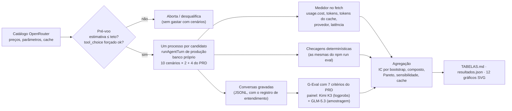

**O que é igual para todos os candidatos** — é o mesmo código de produção (`runAgentTurn`): mesmas instruções, mesmas 10 tools, mesmos guardrails em código, passo 0 forçado em `recordUnderstanding`, temperatura 0,2, até 6 passos, até 800 tokens de saída por passo, histórico de 20 mensagens. Só muda `LLM_MODEL=openrouter/<modelo>`.

**Raciocínio:** em produção o Gemini roda com `thinkingLevel: "minimal"`. Pelo OpenRouter, todos recebem `reasoning.effort: "minimal"`, que o OpenRouter traduz para o `thinkingLevel` do Gemini e para o nível mais próximo nos outros modelos ([docs de reasoning tokens](https://openrouter.ai/docs/use-cases/reasoning-tokens)). A exceção é o Qwen, testado também com `effort: "none"` (ver achados).

**Linha de base justa:** o próprio Gemini 3.5 Flash também roda pelo OpenRouter, com o mesmo medidor de custo e o mesmo caminho de rede. Comparar o Gemini direto com os outros via OpenRouter misturaria o modelo com o gateway.

**Cenários — 24 conversas por candidato:**

- os **10 cenários do `npm run eval`** (dúvida na central, artigo que não vale para o caso, consulta sem número, chamado vencido, privacidade, fora de escopo, pedido de analista, complemento de chamado, duplicidade e abertura de chamado em duas mensagens), **2 repetições**;
- **4 cenários tirados do PRD** que os 10 não cobrem, 1 repetição (orçamento): reabrir chamado resolvido há até 7 dias (Anexo A), confirmar o rascunho por texto (História 4), caso crítico para a empresa toda (História 5 e Anexo A) e mensagem vaga que não pode virar ação ("Qualidade das decisões"). Ficam em [`evals/benchmark/scenarios-prd.ts`](../../evals/benchmark/scenarios-prd.ts), com a fonte de cada um.

O banco é recriado a cada repetição e o sistema legado roda sem falhas simuladas (`LEGACY_FAILURE_RATE=0`), para que a variação venha do modelo. Os candidatos rodam em processos separados (3 ao mesmo tempo), cada um com seu SQLite.

## 3. Candidatos

Critérios de seleção: suportar `tools` **e** `tool_choice` no catálogo do OpenRouter (o agent força a primeira tool), ser forte em português, e cobrir as faixas de preço. Preços do catálogo em 27/10/2026 (US$ por 1M de tokens).

| Modelo | Faixa | Entrada | Saída | Leitura do cache | Por que entrou |
|---|---|---|---|---|---|
| `google/gemini-3.5-flash` | premium | 1,50 | 9,00 | 0,15 | Linha de base: o modelo de produção. |
| `google/gemini-3.8-flash` | intermediária | 0,825 | 4,125 | 0,0825 | Flash mais novo e ~45% mais barato por token: upgrade sem trocar de fornecedor. |
| `google/gemini-3.5-flash-lite` | econômica | 0,30 | 2,50 | 0,03 | Mesmo fornecedor e geração, ~5× mais barato: o "downgrade" óbvio. |
| `openai/gpt-6-luna` | econômica | 0,10 | 0,50 | 0,01 | Modelo rápido e barato da OpenAI para chat de alto volume. |
| `deepseek/deepseek-v4.1-flash` | econômica | 0,14 | 0,42 | 0,0042 | Pesos abertos, ~40 provedores no OpenRouter: preço baixo com roteamento variável. |
| `mistralai/mistral-small-2603` (Mistral Small 4) | econômica | 0,15 | 0,60 | 0,015 | Família europeia, tool calling nativo: diversidade de fornecedor. |
| `qwen/qwen3.8-flash` | econômica | 0,15 | 0,47 | 0,016 | Alibaba, forte em multilíngue. Duas configurações: com raciocínio mínimo e sem raciocínio. |

Os preços exatos usados nas contas (inclusive o de escrita no cache) ficam em [`results/precos.json`](../../evals/benchmark/results/precos.json), gravados a cada execução.

Ficaram de fora antes de gastar: modelos sem `tool_choice` no catálogo (ex.: `cohere/command-a-plus`), modelos premium acima de US$ 2/1M de entrada (não cabem no orçamento com 2 repetições) e qualquer modelo da Anthropic.

## 4. Métricas

| Dimensão | Como é medida | Vira nota 0–1 assim |
|---|---|---|
| **Efetividade** (peso 40%) | % de conversas que passam em **todas** as checagens determinísticas do cenário (intenção, tools esperadas e proibidas, transferência, sem vazar dados de outra pessoa) e sem erro técnico. Também medidos: % de turnos que começam por `recordUnderstanding` (abaixo de 95% desqualifica) e % de tools pedidas pelo modelo que não executaram (nome/argumento inválido). | a própria taxa |
| **Qualidade** (30%) | G-Eval, 7 critérios de 1 a 5 tirados do PRD, média do painel de juízes (seção 5) | (nota − 1) / 4 |
| **Latência** (15%) | p50 do tempo do turno inteiro (todos os passos, como o funcionário sente); também p95 e tempo até a primeira palavra | 1 em 2 s, 0 em 12 s, linear |
| **Custo** (15%) | `usage.cost` que o OpenRouter devolve em cada chamada ([usage accounting](https://openrouter.ai/docs/use-cases/usage-accounting)) — custo real cobrado, **já com o desconto do cache do provedor** — por turno × 3 turnos por atendimento | escala log: 1 em US$ 0,001, 0 em US$ 0,10 por atendimento |

As âncoras de latência e custo são **absolutas** (não "relativas ao melhor"), para a nota de um modelo não mudar quando outro entra ou sai da comparação. O custo usa escala log porque os preços variam em ordens de grandeza: ficar 10× mais barato vale o mesmo tanto em qualquer ponto da escala. O relatório também calcula o composto **sem cache** (custo contrafactual, mesmos tokens pelo preço cheio), para mostrar quanto da posição de cada modelo vem do cache (seção 8).

Com 24 conversas por candidato, as taxas têm **intervalo de confiança de 95% por bootstrap** (2.000 reamostragens, semente fixa). Os intervalos são largos — e o relatório mostra isso em vez de esconder.

## 5. Qualidade com G-Eval, amarrada ao PRD

[G-Eval](https://arxiv.org/abs/2303.16634) (Liu et al., 2023) avalia texto com um LLM em três passos, aplicados aqui assim:

1. **Auto-CoT:** para cada critério, o juiz escreve os passos de avaliação a partir da definição. Gerados **uma vez** e congelados em [`results/passos-geval.json`](../../evals/benchmark/results/passos-geval.json) — reprodutíveis e revisáveis por gente.
2. **Form-filling:** o juiz recebe as **mesmas instruções que o agent recebeu**, a conversa (mensagens, ações do agent com entrada e saída, cards mostrados e o **registro de entendimento** de cada turno, o mesmo que o funcionário vê no painel "por quê?") e os passos, e preenche só as notas.
3. **Nota ponderada pela probabilidade:** em vez da nota inteira escolhida, a média `Σ p(nota) × nota` sobre os dígitos 1–5, com as probabilidades tiradas dos *logprobs* do token da nota. Isso gera notas contínuas e separa empates que a nota inteira esconde.

### Critérios e de onde vêm

O PRD diz como o desafio avalia o agent ("Como vamos avaliar": **qualidade das decisões**, **condução da conversa** e **transparência**), e o Anexo A lista as regras do service desk. Cada critério do G-Eval sai de um desses pontos:

| Critério (1–5) | O que o juiz olha | Fonte no PRD | Onde está no projeto |
|---|---|---|---|
| **Qualidade da decisão** | Entende o pedido e escolhe a ação certa para a intenção; usa só dados das ferramentas | "Como vamos avaliar: Qualidade das decisões"; métricas de sucesso (resolução sem fila, encaminhamento certo) | specs/02-agent, `instructions.ts` |
| **Regras do service desk** | Confirmação antes de criar, sem duplicar, reabrir resolvido há até 7 dias, transferência nos casos certos, privacidade, escopo, prioridade | Anexo A; Segurança e privacidade | specs/01-regras-do-service-desk, specs/03 |
| **Condução da conversa** | Uma pergunta por vez, não repete o que já foi dito, confirma antes de agir, mantém o contexto | "Como vamos avaliar: Condução da conversa"; História 4 | `instructions.ts`, specs/02 |
| **Clareza da resposta** | Até 3 frases, sem jargão, sem repetir o card, sem ecoar notas internas | "Condução da conversa" (responde de forma clara); eficiência | `instructions.ts`, `model-history.ts` |
| **Transparência do raciocínio** | O registro de entendimento de cada turno: intenção certa, "o que entendeu" fiel, confiança calibrada, motivo coerente com a ação | "Como vamos avaliar: Transparência"; visibilidade das decisões, que o PRD chama de "a parte mais importante do desafio" | `tools/understanding.ts`, specs/02 (trace) |
| **Tom e empatia** | Cordial e profissional com quem tem um problema | Contexto: o agent substitui o formulário | `instructions.ts` |
| **Português do Brasil** | Gramática, vocabulário brasileiro, sem inglês desnecessário | Contexto: funcionários de empresa brasileira no chat | `instructions.ts` |

A definição completa de cada critério está em [`evals/benchmark/geval.ts`](../../evals/benchmark/geval.ts) e repetida em [TABELAS.md](TABELAS.md#qualidade--g-eval-média-do-painel-15).

**Transparência** é o critério novo em relação a um G-Eval genérico de chatbot: o juiz não lê só a resposta, lê o `recordUnderstanding` que o agent é obrigado a chamar no passo 0 — intenção, o que entendeu, confiança e motivo — e confere se ele bate com a mensagem e com o que o agent fez depois. Um modelo que acerta a ação mas registra uma intenção errada ou uma confiança de 0,99 numa mensagem ambígua perde aqui.

### Painel de juízes

PoLL — [Verga et al., 2024](https://arxiv.org/abs/2404.18796): um painel de modelos menores e de famílias diferentes concorda mais com humanos e tem menos viés que um juiz grande só.

| Juiz | Por quê | Método da nota |
|---|---|---|
| `moonshotai/kimi-k3` | Família que não concorre; expõe logprobs pelo OpenRouter com o raciocínio desligado (testado) | logprobs (média ponderada), 1 chamada |
| `z-ai/glm-5.3` | Família que não concorre; **não** devolve logprobs pelo OpenRouter e não aceita desligar o raciocínio (testado) | média de **2 amostras** a temperatura 1 — o estimador que o artigo usou com o GPT-4, que também não expunha logprobs (n=2 em vez de 3 para caber no orçamento; a variância a mais aparece nos ICs) |

**Vieses conhecidos de LLM-como-juiz e o que foi feito** ([Zheng et al., 2023](https://arxiv.org/abs/2306.05685); [Panickssery et al., 2024](https://arxiv.org/abs/2404.13076)):

| Viés | Mitigação |
|---|---|
| Autopreferência (o juiz favorece texto da própria família) | Nenhum juiz é da família de um candidato; avaliação cega (o juiz não sabe o modelo) |
| Verbosidade (preferir respostas longas) | Critério de clareza e instrução explícita: "não premie respostas longas: até 3 frases" |
| Posição (em comparação par a par) | Avaliação individual (pointwise), não par a par |
| Juiz leniente ou mal calibrado | Calibração com 3 conversas escritas à mão (excelente, mediana, ruim — esta com eco de nota interna e registro de entendimento errado): o juiz precisa ordená-las certo |
| Um juiz só | Painel de 2 juízes; a concordância entre eles é reportada |

Conversas com erro técnico do provedor (turno sem resposta) **não vão ao juiz**: já contam como falha na efetividade, e uma nota de "qualidade" de uma conversa vazia mediria o provedor, não o modelo.

### Calibração e concordância dos juízes

Antes de avaliar os candidatos, cada juiz avaliou três conversas escritas à mão com qualidade conhecida ([`calibration.ts`](../../evals/benchmark/calibration.ts)). Os dois ordenaram certo, com distância grande entre os níveis:

| Juiz | Método | Excelente | Mediana | Ruim | Ordem certa? |
|---|---|---|---|---|---|
| Kimi K3 | logprobs (média ponderada) | 4,70 | 2,51 | 1,13 | ✓ |
| GLM-5.3 | amostragem (n=2) | 4,93 | 3,00 | 1,36 | ✓ |

Nas 152 conversas avaliadas pelos dois, a correlação de Spearman entre as notas é **0,68** e a diferença média absoluta é **0,20 ponto**. O GLM é mais generoso (média 4,75 contra 4,60), mas os dois concordam nas pontas: Gemini 3.8 Flash em 1º em qualidade e Mistral Small 4 em último; o GPT-6 Luna fica em 2º no Kimi e em 3º no GLM ([TABELAS.md](TABELAS.md#qualidade--g-eval-média-do-painel-15), colunas "só Kimi K3" e "só GLM-5.3").

## 6. Resultados

Todos os números abaixo vêm de [TABELAS.md](TABELAS.md) e de [`resultados.json`](resultados.json), gerados por `npm run benchmark -- --report` a partir das conversas e julgamentos gravados em [`evals/benchmark/results/`](../../evals/benchmark/results). Os gráficos usam a mesma paleta, têm fundo próprio (leem bem no tema claro e no escuro) e mostram o valor de cada marca ao passar o mouse quando abertos direto.

### Score composto

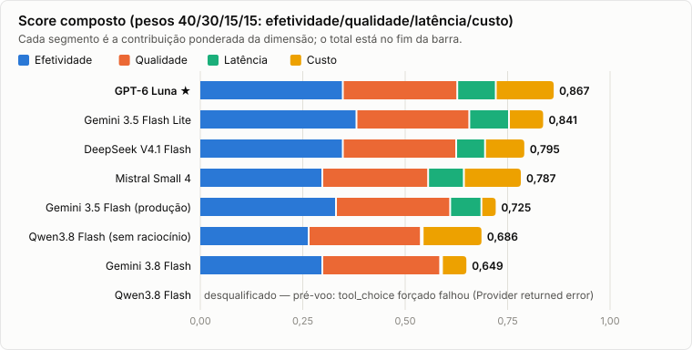

**O Luna vence pelo custo e não perde em nada que pese mais.** A barra do Lite tem o maior segmento de efetividade (0,958 × 40% = 0,383 contra 0,350 do Luna), mas o segmento de custo do Luna (0,956 × 15% = 0,143 contra 0,086) compensa a diferença com folga. O Qwen sem raciocínio não foi desqualificado; ficou em 6º por erros de provedor e latência. O Qwen com raciocínio foi desqualificado no pré-voo, sem gastar com cenários.

### Qualidade × custo (Pareto)

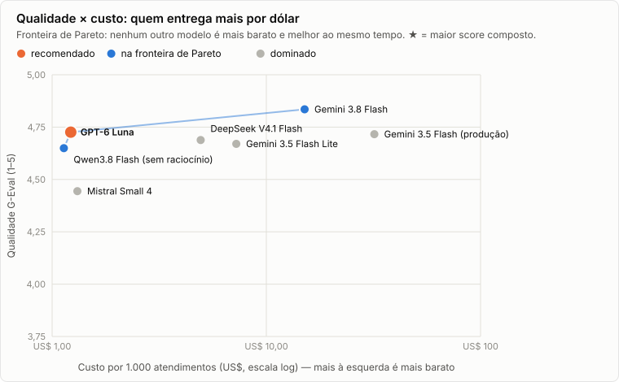

**O modelo de produção é dominado:** o Luna tem a mesma qualidade (4,73 contra 4,72) por 1/26 do custo. Na fronteira ficam o Qwen (o mais barato, US$ 1,13), o Luna e o Gemini 3.8 Flash (a melhor qualidade, 4,84), e cada um desses três só perde para outro modelo em uma das duas dimensões. O gráfico só olha qualidade e custo: o Gemini 3.8 está na fronteira, mas perde no composto por latência e erros de provedor.

### Efetividade

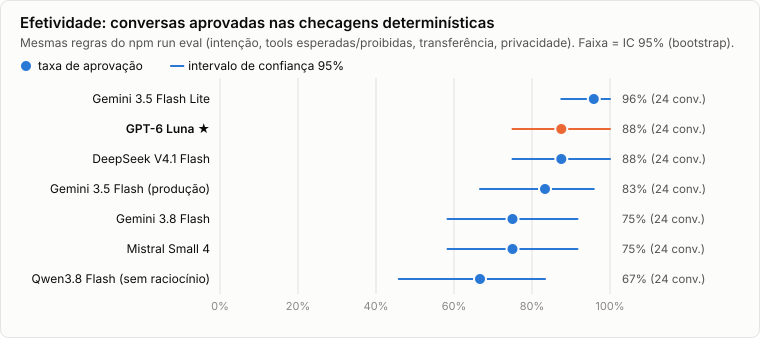

**O Lite é o que mais acerta (96%), mas os intervalos se sobrepõem:** com 24 conversas por modelo, 96% do Lite, 88% do Luna e do DeepSeek e 83% da produção não se separam com segurança estatística. Todos os modelos começaram 100% dos turnos por `recordUnderstanding` e nenhum pediu tool inválida ([TABELAS.md](TABELAS.md#efetividade--checagens-determinísticas)).

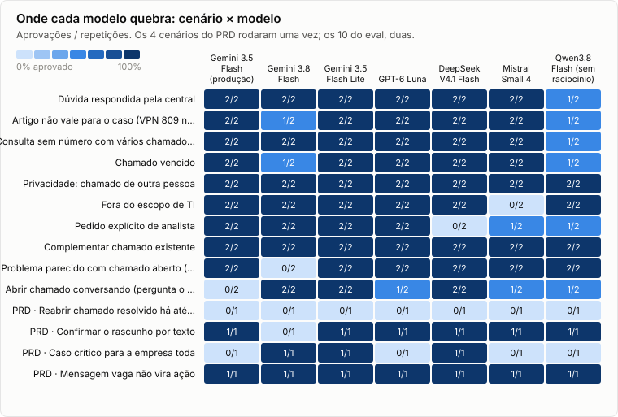

**Os erros se concentram em três cenários, e dois deles apontam para o prompt, não para o modelo:** *reabrir chamado resolvido* (0 de 7 passa), *caso crítico* (4 de 7 não agem) e *abrir chamado conversando* (a produção pede uma 3ª informação nas duas repetições). O resto é específico de cada modelo: DeepSeek pergunta o assunto antes de transferir para o analista (0/2), Mistral indica o RH mas registra a pergunta do holerite como dúvida de TI (0/2), e Gemini 3.8 e Qwen perdem conversas por erro do provedor ([seção 9](#9-achados-e-falhas)).

### Qualidade por critério

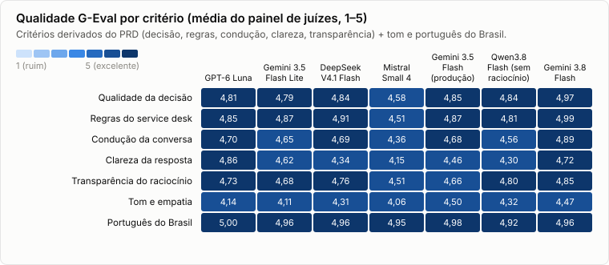

**Todos ficam acima de 4,4; o que separa os modelos é clareza e tom.** Em clareza, o Luna tem a maior nota (4,86) e a produção fica em 4,46. Em tom, a produção é a mais calorosa (4,50) e o Luna e o Lite estão entre os mais secos (4,14 e 4,11; o Mistral tem 4,06). Português do Brasil é praticamente 5 em todos (de 4,92 a 5,00): não é critério de desempate. Em transparência, que o PRD chama de a parte mais importante do desafio, todos ficam entre 4,51 e 4,85.

### Latência

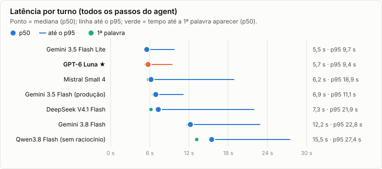

**Lite e Luna respondem em ~5,5 s na mediana e ~9,5 s no p95.** Gemini 3.8 Flash (12,2 s) e Qwen (15,5 s) passam do limite em que a nota de latência zera (12 s). DeepSeek e Mistral têm mediana boa e cauda longa (p95 de 21,9 s e 18,9 s), por troca de provedor e por limite de taxa. A primeira palavra demora quase o turno inteiro porque o texto só sai depois das tools, no último passo.

### Custo e projeção mensal

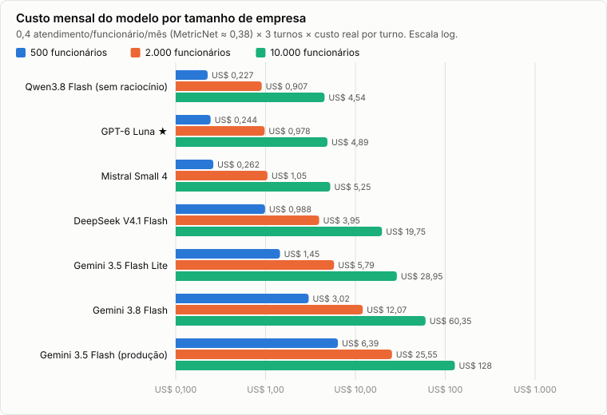

**Para 10 mil funcionários, o modelo custa de US$ 4,54 (Qwen) a US$ 127,73 (produção) por mês.** Mesmo o mais caro fica abaixo de 0,3% do custo de atender o mesmo volume no nível 1 humano: 4.000 atendimentos × US$ 15,56 = **US$ 62.240 por mês** (MetricNet/HDI). Em valor absoluto, o custo do modelo não decide o caso de negócio; quem decide é a taxa de resolução sem fila. O custo continua sendo um critério legítimo de desempate, porque escala linearmente com o volume e porque a qualidade empata.

### Sensibilidade aos pesos

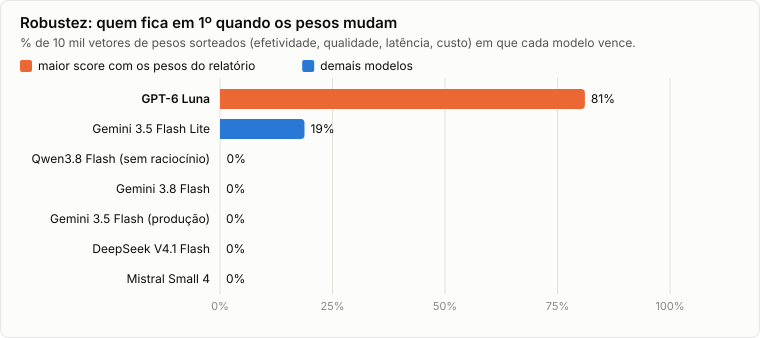

**A escolha não depende dos pesos: o Luna é 1º nos quatro perfis (equilibrado, qualidade, custo e latência primeiro) e em 81% de 10 mil vetores de pesos sorteados.** O Lite vence os outros 19%. Pelas notas, isso acontece, aproximadamente, quando o peso da efetividade passa de 4,6× o peso do custo: a diferença de composto entre os dois é −0,083·w<sub>efet.</sub> + 0,013·w<sub>qual.</sub> − 0,020·w<sub>lat.</sub> + 0,386·w<sub>custo</sub>. Nenhum outro modelo passa de 0,2%.

## 7. Por que o GPT-6 Luna

**Os números que decidem:**

1. **Custo:** US$ 1,22 por 1.000 atendimentos, 5,9× menos que o Lite e 26× menos que a produção ([gráfico 6](#custo-e-projeção-mensal); [TABELAS.md](TABELAS.md#custo-real-e-projeção-mensal)). Metade dessa vantagem vem do cache: sem ele seriam US$ 2,48 ([gráfico 10](#8-engenharia-de-cache)).
2. **Efetividade e qualidade empatadas com o topo:** 88% [75–100%] e 4,73 [4,64–4,80], dentro dos intervalos da produção e do Lite ([gráficos 2 e 4](#efetividade)).
3. **Melhor clareza do painel:** 4,86 de 5 ([gráfico 4](#qualidade-por-critério)), o critério que cobra o "no máximo 3 frases, sem repetir o card" das instruções.
4. **Rápido e estável:** p50 de 5,7 s, o menor p95 (9,4 s), 0 erro de provedor e 0 retentativa por limite de taxa em 94 chamadas, todas na OpenAI ([TABELAS.md](TABELAS.md#provedores-que-atenderam-chamadas)).
5. **Robusto aos pesos:** 1º em 81% das combinações ([gráfico 7](#sensibilidade-aos-pesos)).

**Trechos em que o vencedor e o vice (ou a produção) diferem.** As conversas completas estão em [`results/conversas/`](../../evals/benchmark/results/conversas) e as notas, em [`results/julgamentos.jsonl`](../../evals/benchmark/results/julgamentos.jsonl). No G-Eval, o juiz devolve **só as notas**: o formato *form-filling* não pede justificativa, por custo e para não enviesar a nota pelo texto que o próprio juiz escreve. As leituras abaixo são minhas, apoiadas na definição do critério que o juiz recebeu.

**Trecho 1 — clareza: Luna × Lite** (*Artigo não vale para o caso*, repetição 1; os dois passam nas checagens)

> **Funcionária:** Minha VPN dá erro 809. Uso Windows 11.
>
> **Luna:** O artigo para o erro 809 orienta reinstalar o cliente de VPN, mas o procedimento vale apenas para Windows 10. Como você usa Windows 11, posso ajudar a abrir um chamado.
>
> **Lite:** O artigo de ajuda para o erro 809 é válido apenas para o Windows 11? Não, ele diz que é para o Windows 10 e orienta abrir chamado no Windows 11. Como você usa Windows 11, posso abrir um chamado para você?

| Clareza | Kimi K3 | GLM-5.3 | Painel |
|---|---|---|---|
| Luna | 4,77 | 5,0 | **4,89** |
| Lite | 2,03 | 3,5 | **2,76** |

O Lite faz uma pergunta a si mesmo e a responde na própria mensagem. O critério pede "resposta direta, em até 3 frases"; os dois tomam a mesma decisão certa, mas a do Luna se lê de uma vez.

**Trecho 2 — onde o Lite é melhor: caso crítico** (*PRD · Caso crítico para a empresa toda*; o Luna reprova na checagem)

> **Funcionário:** O sistema de faturamento caiu e ninguém da empresa consegue emitir nota fiscal agora.
>
> **Luna:** Não encontrei uma solução de autoatendimento nem um chamado aberto relacionado. A emissão de notas está totalmente bloqueada ou há uma alternativa para emitir? *[botões: Estamos bloqueados · Há compromisso hoje · Temos alternativa · Sem urgência]*
>
> **Lite:** *(monta o rascunho do chamado na hora)* … Preparei o chamado para o sistema de faturamento indisponível que afeta toda a empresa. Posso confirmar a abertura? *[botões: Sim, criar chamado · Falar com um analista]*

O PRD manda agir em caso crítico (Anexo A: transferência "em casos críticos"; prioridade crítica = parado para a empresa). A mensagem já diz que a empresa toda está parada, e o Luna ainda pergunta a urgência. Os juízes não punem isso (condução 4,93 para o Luna), porque perguntar uma coisa por vez é exatamente o que as instruções pedem. Por isso o benchmark tem as duas camadas: a checagem determinística pega o que o PRD exige, e o G-Eval avalia a forma da conversa. A produção e o Qwen erram do mesmo jeito; o Mistral escreve "Vou abrir um chamado urgente para isso" e não chama tool nenhuma. Ver o [achado 2](#9-achados-e-falhas).

**Trecho 3 — Luna × produção** (*Problema parecido com chamado aberto*, repetição 2; os dois passam nas checagens)

> **Funcionária:** Meu notebook continua muito lento depois da atualização do Windows.
>
> **Luna** — registro: `ticket_update`, confiança 0,96, "O notebook da funcionária continua muito lento após uma atualização do Windows; ela quer ajuda com esse problema recorrente." Resposta: Encontrei um chamado sobre lentidão no notebook após a atualização do Windows. É sobre esse chamado? *[botões: Sim, é esse chamado · Não, é outro problema]*
>
> **Produção** — registro: `confirm_or_choose`, confiança 1, "a usuária tem um chamado aberto e vencido (INC-20311)…". Resposta: Olá, Ana. Encontrei o chamado **INC-20311** aberto sobre a lentidão do seu notebook após a atualização do Windows, que está com o prazo de retorno vencido. Você gostaria de falar diretamente com um analista sobre ele ou prefere adicionar alguma informação nova? *[lista para escolher entre os 3 chamados abertos]*

| | Condução | Transparência | Clareza | Geral |
|---|---|---|---|---|
| Luna | 4,97 | 4,73 | 4,90 | **4,78** |
| Produção | 3,64 | 3,17 | 4,06 | **4,06** |

O registro de entendimento da produção descreve o que **o agent achou**, não o que **a funcionária disse**, e marca a intenção como escolha de opção numa mensagem que relata um problema. A transparência cai (3,17). Na conversa, a produção pula a confirmação de que o problema é aquele chamado, oferece duas ações e mostra uma lista de três chamados, enquanto o texto fala de um só. A condução também cai (3,64).

**Onde o Luna perde, para a decisão ser informada:**

- **Caso crítico** (trecho 2) e **abrir chamado conversando**, repetição 2: pede uma 3ª informação (a urgência) quando a funcionária já disse que há alternativa. Foi a mesma falha da produção, nas duas repetições dela.
- **Transparência num turno:** em *Abrir chamado conversando*, repetição 1, registra a intenção `ticket_update` enquanto monta um chamado novo; os juízes dão 3,09 em transparência ([`julgamentos.jsonl`](../../evals/benchmark/results/julgamentos.jsonl)).
- **Tom:** 4,14, mais seco que a produção (4,50).
- **Arquitetura:** exige o OpenRouter (ou uma chave da OpenAI) em produção, em vez da chave do Google que o app já usa. Ver a [seção 10](#10-recomendação-e-projeção-de-negócio).

## 8. Engenharia de cache

O agent manda ~6–12 mil tokens de entrada por turno (instruções, 10 tools, histórico), e quase tudo se repete de uma chamada para a outra. Cache de prompt é o provedor cobrar menos, e responder mais rápido, pela parte do prompt que ele já viu. O benchmark usou isso em três lugares e mediu cada um.

### O que cada provedor faz (verificado na documentação e medido)

| Família | Regra documentada ([OpenRouter: prompt caching](https://openrouter.ai/docs/features/prompt-caching)) | Leitura do cache (× preço cheio) | Medido no benchmark |
|---|---|---|---|
| OpenAI (GPT-6 Luna) | Automático a partir de 1.024 tokens de prefixo idêntico; escrita a 1,25× | 0,10× | **71%** do prompt |
| Google (Gemini) | Implícito a partir de ~1.000 tokens; explícito com `cache_control` | 0,10× | **0%** em 286 chamadas |
| DeepSeek | Automático | 0,03× | **48%** (cache é por provedor, e o roteamento variou) |
| Mistral | Não documentado no OpenRouter | 0,10× | **85%** |
| Qwen (Alibaba) | Documentado como explícito (`cache_control`) | 0,11× | **91%**, sem `cache_control` |

O que a documentação diz e o que acontece não coincidem em dois casos: o Qwen fez cache sem `cache_control`, e o Gemini não fez cache nenhum pelo OpenRouter. Num teste à parte com o Gemini 3.5 Flash Lite, a requisição real do agent (2.576 tokens) não fez cache em nenhuma tentativa, nem implícito nem com `cache_control` (no início do prompt ou na última mensagem). Com as instruções repetidas até 4.898 tokens, só 1 de 3 chamadas leu do cache (3.529 tokens; custo de US$ 0,00158 para US$ 0,00063). Inflar o prompt para "ligar" o cache só compensaria com acerto acima de ~85%. **Para o Gemini, o prompt enxuto continua sendo o mais barato.**

### O que mudou no app para o cache funcionar

O Mastra monta cada chamada assim: `[system: instruções] → [system: briefing do turno] → histórico`, com as 10 tools. O briefing trazia a **hora com minutos**, então o meio do prompt mudava a cada minuto e invalidava o cache de tudo que vinha depois. Duas mudanças, no commit `bd21b04`:

1. **Briefing com a hora cheia** ([`turn-briefing.ts`](../../src/agent/turn-briefing.ts), `formatHour`: "ter., 27/10, 16h"): o prefixo fica idêntico entre os turnos da mesma hora. O briefing serve para o agent saber o dia da semana e o horário comercial, e para isso a resolução de hora basta.
2. **`session_id` = id da conversa** no pedido ao OpenRouter ([`model-config.ts`](../../src/agent/model-config.ts)): as chamadas de uma conversa vão para o mesmo provedor, que é onde o cache está.

O caminho padrão (Gemini direto) não muda de comportamento: os 10 cenários do `npm run eval` continuaram passando (10/10) depois da mudança.

**Antes × depois** (mesmo cenário, *Abrir chamado conversando*, uma conversa por modelo; arquivos em [`results/experimento-cache/`](../../evals/benchmark/results/experimento-cache)):

| Modelo | Acerto de cache | Tokens cacheados no 1º passo do 2º turno | Custo da conversa |
|---|---|---|---|
| GPT-6 Luna | 75% → **83%** | 0 → **1.896** de 2.118 | US$ 0,00108 → **US$ 0,00082 (−24%)** |
| Qwen3.8 Flash (sem raciocínio) | 82% → **91%** | 2.816 → 2.816 | US$ 0,00156 → **US$ 0,00115 (−26%)** |
| DeepSeek V4.1 Flash | 77% → 52% | 3.072 → 2.053 | US$ 0,00244 → US$ 0,00624 — trocou de provedor no meio da conversa; o cache não vai junto |
| Mistral Small 4 | 68% → — | — | sem dado depois (limite de taxa, HTTP 429) |

As duas mudanças entraram juntas; o experimento não separa o efeito de cada uma.

### Cache nos juízes e cache local de respostas

- **Prompt do juiz com a parte fixa primeiro:** papel, instruções do agent, critérios, passos e formato vão na mensagem de sistema, e a conversa avaliada vai por último ([`geval.ts`](../../evals/benchmark/geval.ts), `judgePrompt`). Resultado: **82%** (Kimi K3) e **88%** (GLM-5.3) do prompt dos juízes saiu do cache do provedor. A economia em dólar é pequena (US$ 0,0069) porque esses provedores quase não dão desconto na leitura (Kimi: US$ 0,149 contra 0,159 por 1M); o ganho maior é de latência.
- **Cache local endereçado por conteúdo:** cada pedido aos juízes é guardado em [`results/respostas.jsonl`](../../evals/benchmark/results/respostas.jsonl) com a chave `sha256(modelo + mensagens + parâmetros)`. Pedido idêntico não é pago de novo, e quem roda o benchmark outra vez com o mesmo código não gasta nada com os juízes. Nesta rodada, pedidos repetidos (passos, calibração e julgamentos refeitos) economizaram US$ 0,0059.

### Resultado

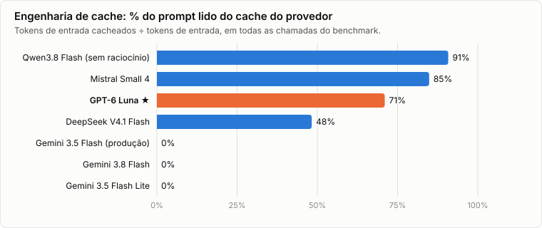

**Qwen, Mistral e Luna leem de 71% a 91% do prompt do cache; os três Gemini, 0%.**

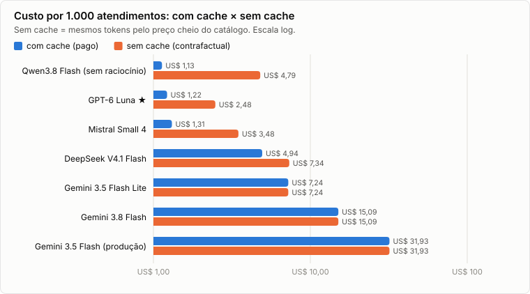

**O cache corta de 33% (DeepSeek) a 76% (Qwen) do custo por atendimento; o Luna paga US$ 1,22 em vez de US$ 2,48.**

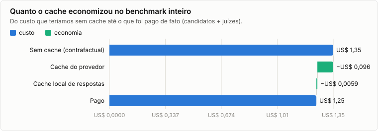

**No benchmark inteiro (candidatos + juízes), o cache do provedor evitou US$ 0,096 e o cache local US$ 0,006: pagamos US$ 1,246 em vez de US$ 1,348 (−7,6%).** A economia é pequena no total porque 94% do gasto foi com os três Gemini e com os juízes, que quase não se beneficiam do cache.

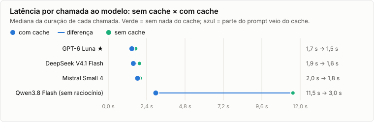

**Nos quatro modelos que fazem cache, a chamada que lê do cache é mais rápida:** Luna 1,7 → 1,5 s, DeepSeek 1,9 → 1,6 s, Mistral 2,0 → 1,8 s (mediana por chamada). No Qwen, as 6 chamadas sem cache levaram 11,5 s contra 3,0 s, mas no Qwen e no Mistral a amostra sem cache (6 chamadas) é pequena demais para medir o tamanho do efeito.

### O cache na escolha do modelo

O custo do composto é o **custo pago, já com cache**, porque é o que a empresa vai pagar. Para ver quanto da posição de cada modelo vem do cache, o relatório também calcula o composto com o custo contrafactual sem cache ([TABELAS.md](TABELAS.md#ranking--score-composto-pesos-40301515), coluna "Composto sem cache"):

- O **Luna continua em 1º sem cache** (0,844); o cache só aumenta a vantagem dele (0,867).
- **Mistral** (0,787 → 0,755) e **Qwen** (0,686 → 0,639, e cai de 6º para 7º) são os que mais dependem do cache.
- **Os Gemini não mudam** (0% de acerto), e por isso, pelo OpenRouter, ficam relativamente mais caros quanto mais longa a conversa.

## 9. Achados e falhas

**Do agent (valem para qualquer modelo):**

1. **O prompt impede reabrir chamado resolvido: 0 de 7 modelos passa.** O Anexo A diz que "chamados resolvidos há até 7 dias podem ser reabertos", e a tool suporta isso (`draftTicketUpdate` com `reopen`). Mas a instrução para problema relatado manda consultar `listMyTickets (onlyOpen)` ([`instructions.ts:21-23`](../../src/agent/instructions.ts)), e `onlyOpen` é `true` por padrão ([`tools/tickets.ts:13`](../../src/agent/tools/tickets.ts)): o INC-20150 (senha do SAP, resolvido há 4 dias) nunca aparece. O único que achou o chamado foi o Lite, que listou todos (`onlyOpen=false`), montou a atualização com reabertura e mesmo assim reprovou, porque no 1º turno também abriu um rascunho novo. Os outros responderam com o artigo de desbloqueio do SAP, o que é razoável. **Sugestão:** instruir `onlyOpen=false` quando o funcionário diz "de novo" ou "voltou", ou levar a regra dos 7 dias para o código, como pede o `AGENTS.md`.
2. **Caso crítico: 4 de 7 não agem.** Com "ninguém da empresa consegue emitir nota fiscal agora", produção, Luna e Qwen ainda perguntam a urgência ou o que já foi tentado, e o Mistral escreve "Vou abrir um chamado urgente" sem chamar tool nenhuma. As instruções listam as perguntas de urgência para "problema novo" sem um atalho para o caso evidente. **Sugestão:** impacto "toda a empresa" + parado → rascunho com prioridade crítica ou transferência, sem mais perguntas.

**Dos modelos e provedores:**

3. **Gemini 3.8 Flash tem a melhor qualidade (4,84) e não está pronto para chat.** O provedor cortou o stream ("The operation was aborted") em 5 de 28 turnos (18%), sempre num passo depois do `recordUnderstanding`, após ~13 s. Além disso, o p50 é de 12,2 s.
4. **Qwen3.8 Flash com raciocínio é incompatível com o agent:** com `reasoning.effort` ligado, o provedor recusa o `tool_choice` forçado ("Provider returned error"). O pré-voo pegou isso por menos de um centavo. Sem raciocínio funciona, mas 18% dos turnos caíram por erro do provedor: 4 com "Provider returned error" e 1 com "Output data may contain inappropriate content", em resposta a "Quero falar com um analista, por favor." O p50 foi de 15,5 s.
5. **Mistral Small 4 sofre com limite de taxa:** 10 retentativas por HTTP 429 (capacidade compartilhada no OpenRouter) e 7% dos turnos ainda falharam depois de 3 tentativas. Em *Fora do escopo*, uma repetição **inventou um e-mail do RH** ("rh@nexo.com.br", que não existe no sistema), contra a regra "nunca invente".
6. **DeepSeek V4.1 Flash varia com o roteamento:** 97 chamadas foram atendidas por 14 provedores diferentes. O cache é por provedor, então só 48% acertou, e o custo de uma mesma conversa variou 2,5× entre execuções. Mesmo com `effort: minimal`, gerou 406 tokens de raciocínio por turno, e o p95 foi de 21,9 s. Quando o funcionário pede um analista, pergunta o assunto antes de transferir (0/2).
7. **GPT-6 Luna não aceita `temperature`:** o Mastra omite o parâmetro para esse modelo, e com `require_parameters` o OpenRouter devolve 404. O Luna roda na temperatura padrão do provedor; os outros, a 0,2. É assim também em produção, então a comparação reflete o uso real, mas não é um controle perfeito.

**Do próprio benchmark:**

8. **Uma métrica estava errada e foi corrigida antes do relatório.** A conformidade do passo 0 lia a 1ª tool do *trace* do turno. Quando o provedor caía no meio do turno, o trace não fechava, e o turno contava como "não chamou `recordUnderstanding`". Isso desqualificava Gemini 3.8 e Qwen com "82% de conformidade", quando os dois, nos turnos que caíram, tinham chamado `recordUnderstanding` no 1º passo. A correção lê, nesses turnos, a tool que o modelo pediu na 1ª chamada que respondeu ([`scoring.ts`](../../evals/benchmark/scoring.ts), `stepZeroTool`, com teste). A queda continua contando contra o modelo na efetividade, onde deve.
9. **A linha de base não é idêntica ao caminho de produção.** Pelo OpenRouter, o Gemini 3.5 Flash reprovou *Abrir chamado conversando* nas duas repetições (pede uma 3ª informação). Direto pelo Google, no `npm run eval`, o mesmo cenário passa. A tradução de `reasoning.effort: minimal` para o `thinkingLevel` do Gemini, ou o próprio caminho, pode mudar o comportamento. A comparação entre candidatos continua justa (todos pelo mesmo caminho), mas a efetividade da produção pode estar subestimada nesse cenário.

## 10. Recomendação e projeção de negócio

| Opção | Mudança | A favor | Contra |
|---|---|---|---|
| Manter Gemini 3.5 Flash | nenhuma | já está em produção; o tom mais caloroso (4,50) | 26× o custo do Luna e 4,4× o do Lite, sem ganhar em efetividade, qualidade ou latência |
| **GPT-6 Luna (recomendado)** | `LLM_MODEL=openrouter/openai/gpt-6-luna` + `OPENROUTER_API_KEY` | maior composto em 81% dos pesos; menor custo entre os que passam de 85% de efetividade; melhor clareza; 0 erro de provedor; 71% de cache | novo fornecedor e novo gateway em produção; não age no caso crítico; tom mais seco (4,14) |
| Gemini 3.5 Flash Lite | `LLM_MODEL=google/gemini-3.5-flash-lite` (mesma chave) | maior efetividade (96%); troca de uma linha, sem dependência nova | 5,9× o custo do Luna; resposta confusa no trecho 1 (clareza 2,76); tom 4,11 |

**Recomendação: GPT-6 Luna**, nesta ordem:

1. **Corrigir os achados 1 e 2** (reabrir e caso crítico) e rodar `npm run eval` com o Luna. O caminho `openrouter/` já existe nesta branch ([`model-config.ts`](../../src/agent/model-config.ts)); para usar a OpenAI direto, falta só incluir `OPENAI_API_KEY` em `apiKeyVarFor`.
2. **Rodada de confirmação Luna × Lite** com 5 repetições, para estreitar o IC de efetividade, que hoje se sobrepõe. Custo estimado pelos números desta rodada: ~US$ 0,65 (Luna US$ 0,03, Lite US$ 0,15, juízes ~US$ 0,47).
3. **Em produção, acompanhar** o `cached_tokens` (o cache é metade da vantagem de custo) e a latência real na Vercel.

Se trocar de fornecedor não for aceitável agora, o **Gemini 3.5 Flash Lite** é a troca segura: uma linha de configuração, a maior efetividade do benchmark e 77% menos custo que o modelo atual.

**Projeção mensal** (premissas: 3 turnos por atendimento; 0,4 atendimento por funcionário por mês, perto dos 0,38 chamado/usuário/mês da MetricNet; cenário alto de 1,0, se o chat atrair dúvidas que antes nem viravam chamado):

| Funcionários | GPT-6 Luna | Gemini 3.5 Flash Lite | Gemini 3.5 Flash (produção) | Nível 1 humano (US$ 15,56/chamado) |
|---|---|---|---|---|
| 500 | US$ 0,24 (alto US$ 0,61) | US$ 1,45 (alto US$ 3,62) | US$ 6,39 (alto US$ 15,97) | US$ 3.112 |
| 2.000 | US$ 0,98 (alto US$ 2,44) | US$ 5,79 (alto US$ 14,47) | US$ 25,55 (alto US$ 63,87) | US$ 12.448 |
| 10.000 | US$ 4,89 (alto US$ 12,22) | US$ 28,95 (alto US$ 72,37) | US$ 127,73 (alto US$ 319,33) | US$ 62.240 |

Trocar a produção pelo Luna economiza US$ 122,84 por mês com 10 mil funcionários (US$ 1.474 por ano; US$ 307 por mês no cenário alto). É pouco perto do custo humano: **o valor do agent está em resolver sem fila, e é por isso que efetividade pesa 40% e custo 15%.** O custo do modelo é o desempate entre modelos que resolvem igual, e foi o que aconteceu aqui. A coluna humana supõe que todo atendimento viraria um chamado de nível 1, então é um teto, não uma economia garantida.

## 11. Limitações

- **Amostra pequena:** 24 conversas por candidato. As diferenças de efetividade entre os quatro primeiros não são estatisticamente significativas (ICs na [tabela](TABELAS.md#efetividade--checagens-determinísticas)), e a escolha se apoia no custo, onde a diferença é de ordem de grandeza.
- **Usuário roteirizado:** as mensagens do funcionário são fixas e não reagem ao agent. No cenário de reabrir, "Sim, é esse mesmo." só faz sentido se o agent perguntou do chamado antigo.
- **Juízes LLM:** concordam moderadamente (Spearman 0,68), notas comprimidas no topo (4,4–4,9) e sem justificativa escrita. As leituras dos trechos da seção 7 são minhas, apoiadas na definição dos critérios.
- **4 conversas do Qwen (repetição 2) ficaram sem nota:** os juízes pararam no teto de gasto com 304 de 312 julgamentos. A qualidade do Qwen vem de 15 conversas, não de 19.
- **Temperatura e caminho:** o Luna roda sem `temperature` (achado 7), e a linha de base passa pelo OpenRouter, não pelo Google direto (achado 9).
- **Preços e roteamento de 27/10/2026:** mudam. O DeepSeek, em especial, depende de qual provedor atende.
- **Custo por atendimento** supõe 3 turnos; os cenários têm 1 ou 2, e conversas reais podem ter mais.
- **Cache do Gemini direto (produção) não medido:** pelo OpenRouter foi 0%.

## 12. Orçamento e reprodutibilidade

- **Pré-voo grátis:** catálogo (`GET /models`) e crédito da chave (`GET /key`). A estimativa usa o preço do catálogo × **tokens medidos** na 1ª rodada (95 turnos de 5 modelos: 6.668 de entrada e 221 de saída por turno, somando todos os passos), com folga para 7.500 e 300, porque tokenizadores variam e há raciocínio. Para o juiz com logprobs, o preço é o do provedor mais barato **que devolve logprobs**, porque é para lá que a chamada vai. Se a estimativa passar do que sobra (US$ 1,80 menos o que a chave já gastou), o benchmark não começa.
- **Porta de entrada:** uma chamada de frações de centavo por candidato confere se o `tool_choice` forçado funciona antes de gastar com cenários.
- **Ao vivo:** cada conversa reporta seu custo real; ao chegar perto do teto (guardando uma reserva de US$ 0,35 para os juízes), os processos são interrompidos. Os juízes param sozinhos no teto.
- **Cache de resultados:** conversas e julgamentos ficam em JSONL em [`evals/benchmark/results/`](../../evals/benchmark/results). Rodar de novo não refaz o que já está lá — `npm run benchmark -- --report` regera relatório e gráficos sem chamar API nenhuma. Chamadas dos juízes passam por um cache endereçado por conteúdo (seção 8).
- **Limite de taxa (HTTP 429)** do provedor não é culpa do modelo: o cenário é refeito numa conversa nova (até 3 tentativas, com espera), e as tentativas e o custo delas ficam registrados.
- **Gasto real:** medido pela diferença de uso da chave antes e depois (`GET /key`), além da soma por chamada.

**Quanto custou de fato** (uso da chave pelo `GET /key`, depois de a contabilidade do OpenRouter fechar):

| Etapa | US$ |
|---|---|
| Antes da rodada definitiva: 1ª rodada (5 candidatos, critérios antigos, descartada), sondas de parâmetros, pré-voo, experimento de cache antes/depois e teste do limiar do Gemini | 0,4956 |
| Rodada definitiva — candidatos (8 configurações, 168 conversas) | 0,5867 |
| Rodada definitiva — juízes (304 julgamentos) | 0,6595 |
| Rodada definitiva — passos do G-Eval, calibração e pré-voo | 0,0537 |
| **Total do estudo** | **1,7955** |
| Crédito restante na chave (limite US$ 2,00) | 0,2045 |

A soma por chamada da rodada definitiva (US$ 1,2999) bate com o uso da chave. Os juízes custaram 37% acima da estimativa (US$ 0,66 contra US$ 0,48): os prompts reais tiveram ~4,1 mil tokens contra 3,5 mil estimados, e o Kimi foi roteado também para provedores mais caros que o mais barato com logprobs. O controle ao vivo parou os juízes no teto, com 8 julgamentos por fazer (limitação na seção 11). Uma estimativa nova (`--dry-run`) recusa rodar o que falta, porque restam US$ 0,0045 até o teto de US$ 1,80.

Para rodar de novo:

```bash
npm run benchmark -- --dry-run
```

mostra a estimativa e o crédito sem gastar nada;

```bash
npm run benchmark
```

roda o que falta (o que já está no cache não é refeito) e regera tudo.

## 13. Fontes

- Liu et al. (2023). *G-Eval: NLG Evaluation using GPT-4 with Better Human Alignment.* [arXiv:2303.16634](https://arxiv.org/abs/2303.16634)
- Verga et al. (2024). *Replacing Judges with Juries: Evaluating LLM Generations with a Panel of Diverse Models.* [arXiv:2404.18796](https://arxiv.org/abs/2404.18796)
- Zheng et al. (2023). *Judging LLM-as-a-Judge with MT-Bench and Chatbot Arena.* [arXiv:2306.05685](https://arxiv.org/abs/2306.05685)
- Panickssery et al. (2024). *LLM Evaluators Recognize and Favor Their Own Generations.* [arXiv:2404.13076](https://arxiv.org/abs/2404.13076)
- OpenRouter: [usage accounting](https://openrouter.ai/docs/use-cases/usage-accounting), [reasoning tokens](https://openrouter.ai/docs/use-cases/reasoning-tokens), [prompt caching](https://openrouter.ai/docs/features/prompt-caching), catálogo `GET /api/v1/models` e endpoints por modelo (consultados em 27/10/2026; preços gravados em [`results/precos.json`](../../evals/benchmark/results/precos.json)).
- MetricNet: ~0,38 chamado por usuário por mês (benchmark de service desk, 2023); MetricNet/HDI: US$ 15,56 por chamado no nível 1, América do Norte (2016).
- PRD do desafio Nexo Assist (v5): "Como vamos avaliar", Anexo A e histórias de usuário; specs do projeto em [`docs/specs/`](../specs).
