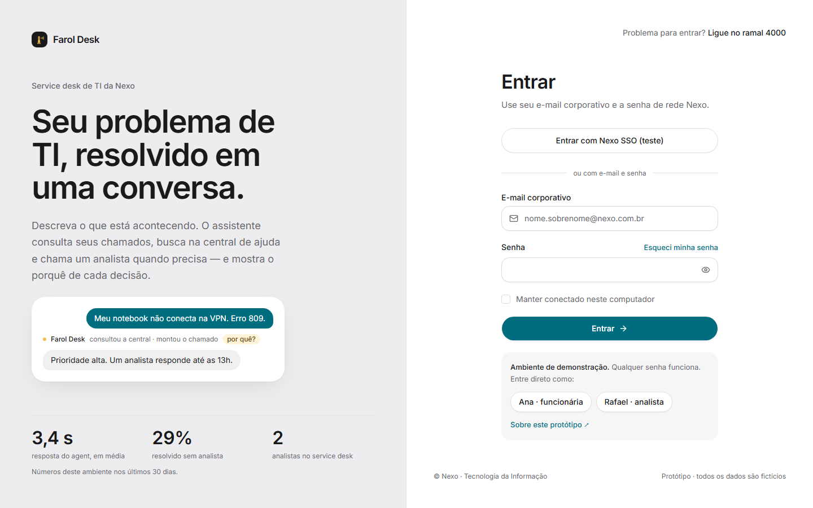
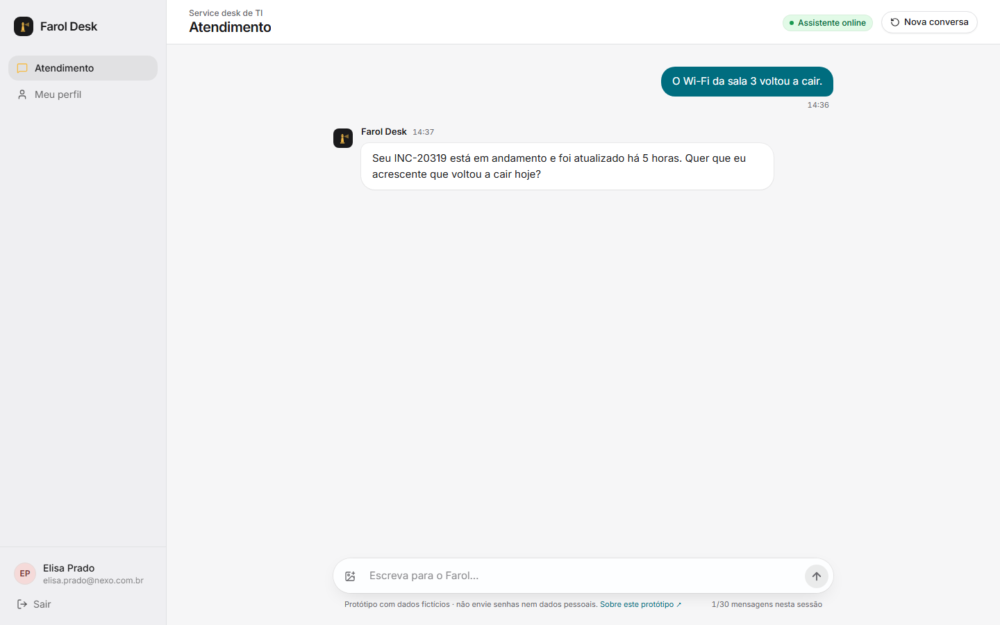
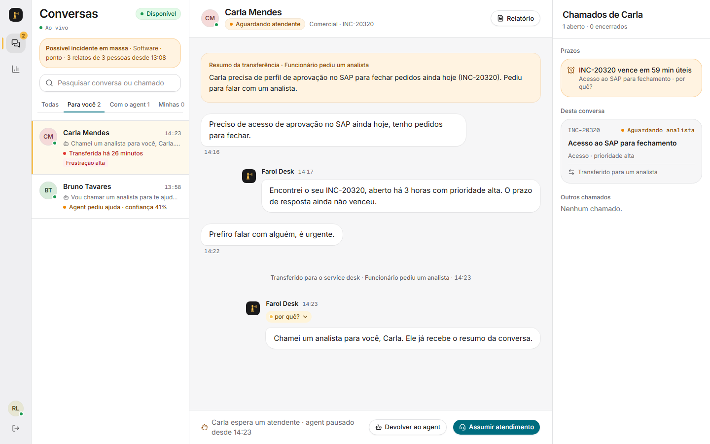
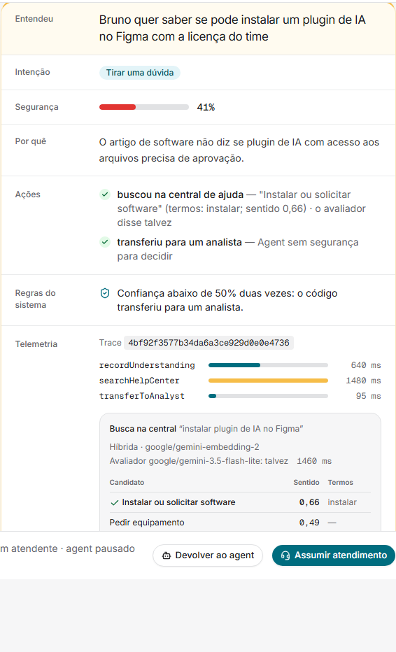
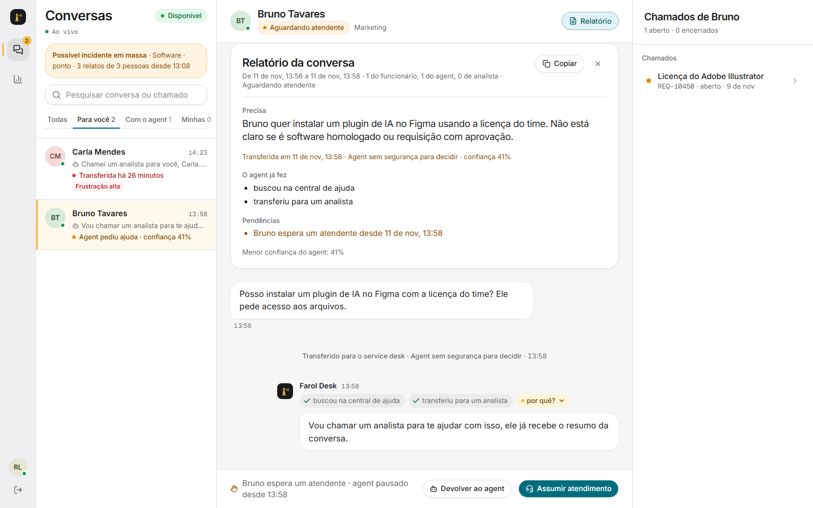
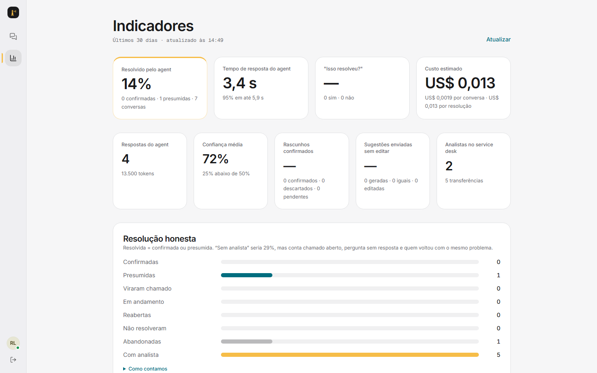
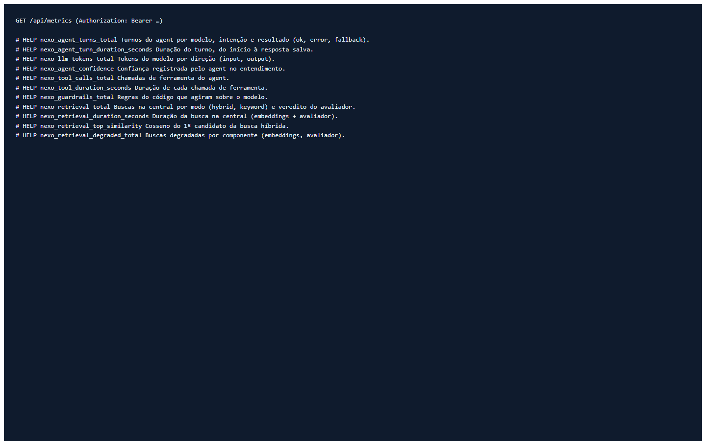
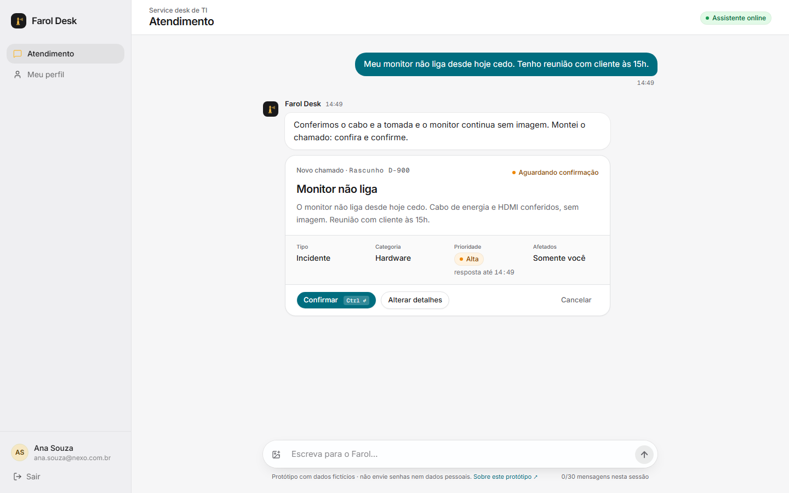

# Capturas das telas (geradas pelo Playwright)

Estas imagens não são feitas à mão: `npm run docs:capturas` sobe o build de produção com o banco do seed, percorre as telas e salva uma captura de cada uma. Antes de cada captura, o teste confere o que a tela mostra. Se a tela mudar, o teste falha em vez de documentar errado. O roteiro está em [`e2e-docs/capturas.spec.ts`](../../e2e-docs/capturas.spec.ts).

| Tela | Captura |
|---|---|
| Login com SSO e o atalho de demonstração |  |
| Chat da funcionária com o histórico |  |
| Console do analista com a fila |  |
| Decisão do agent com a telemetria do turno (id do trace, tempo das ferramentas, raio-X da busca) |  |
| Relatório da conversa |  |
| Indicadores do service desk |  |
| `/api/metrics` no formato do Prometheus |  |
| Chat da funcionária com o rascunho de chamado para confirmar |  |
